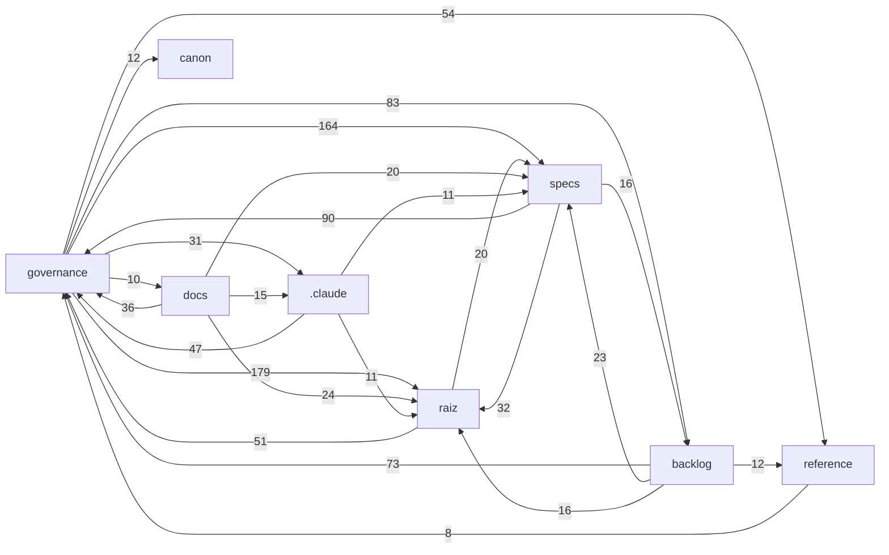

# MAPA DO PROJETO — SOT Harness

> **NÃO-NORMATIVO e REGENERÁVEL** (BL-019). Não é baseline (INV-09), não substitui o [CATALOGO-OFICIAL](../../governance/CATALOGO-OFICIAL.md) — que segue como locator autoritativo — e não fecha decisão aberta (CONS-01). Em conflito, vale o documento de origem.
>
> Regenerar: `python scripts/build_map.py` · Verificar defasagem: `python scripts/build_map.py --check`

Gerado em **2026-09-29** · digest `4e94bee85164557e` · **191** documentos · **1856** arestas doc→doc · fontes: `scripts/check_refs.py`, `scripts/backlog_triggers.py`

## 1. Camadas (por diretório)

| Área | Docs | Função | Mais referenciados |
|---|---:|---|---|
| **raiz** | 5 | entradas: ROADMAP, atomic-spec, AGENTS, GLOSSARIO, README | [ROADMAP.md](../../ROADMAP.md) (117) · [atomic-spec.md](../../atomic-spec.md) (69) · [AGENTS.md](../../AGENTS.md) (26) |
| **governance** | 96 | autoridade normativa: Constituição, RULES, CATALOGO, atas DHR, emendas EUA | [RULES.md](../../governance/RULES.md) (133) · [CONFLICT-MAP.md](../../governance/CONFLICT-MAP.md) (83) · [DHR-EUA-E04_Ata_Homologacao_Heranca_Delta.md](../../governance/DHR-EUA-E04_Ata_Homologacao_Heranca_Delta.md) (61) |
| **canon** | 8 | modelos canônicos BASELINED (CHM/CEM/CEE/GMC/SDD/PPQ/SAS/CR) | [CEE-001-cognitive-economy-efficiency-v2.0.md](../../canon/CEE-001-cognitive-economy-efficiency-v2.0.md) (57) · [CEM-001-canonical-evidence-model.md](../../canon/CEM-001-canonical-evidence-model.md) (52) · [CHM-001-canonical-hypothesis-model.md](../../canon/CHM-001-canonical-hypothesis-model.md) (46) |
| **specs** | 20 | Specs por feature (plan.md + checks.md) e specs de agente | [SPEC-001/plan.md](../../specs/features/SPEC-001/plan.md) (66) · [SPEC-019/plan.md](../../specs/features/SPEC-019/plan.md) (62) · [SPEC-020/plan.md](../../specs/features/SPEC-020/plan.md) (45) |
| **backlog** | 5 | RMR-001 e backlogs (gatilhos de ativação) | [RMR-001_Painel_Backlog.md](../../backlog/RMR-001_Painel_Backlog.md) (86) · [BL-018-RISK-AGENT-backlog.md](../../backlog/BL-018-RISK-AGENT-backlog.md) (13) · [BL-016-MC-SKL-001-encaminhamento.md](../../backlog/BL-016-MC-SKL-001-encaminhamento.md) (9) |
| **reference** | 20 | referências externas não-normativas (camadas, master contracts) | [MC-COG-001_Master_Contract_Camada_Cognicao.md](../../reference/camadas/MC-COG-001_Master_Contract_Camada_Cognicao.md) (10) · [MC-RAG-001_Master_Contract_Camada_RAG.md](../../reference/camadas/MC-RAG-001_Master_Contract_Camada_RAG.md) (10) · [CACHING SOT.MD](../../reference/externo/CACHING%20SOT.MD) (8) |
| **rag** | 5 | chunks de conhecimento por agente | [synthesis.knowledge.md](../../rag/synthesis.knowledge.md) (2) |
| **.claude** | 14 | agentes e skills do Claude Code | [revisor.md](../../.claude/agents/revisor.md) (23) · [especificador.md](../../.claude/agents/especificador.md) (22) · [sot-schema-validator.md](../../.claude/agents/sot-schema-validator.md) (2) |
| **docs** | 13 | documentação histórica e de arranque (não essencial à operação) | [PARECER-RISK-AGENT-auditoria-semantica.md](../../docs/arranque/PARECER-RISK-AGENT-auditoria-semantica.md) (3) · [parecer-revisor-F1.md](../../docs/arranque/parecer-revisor-F1.md) (3) · [questionario-resolucao-v1.md](../../docs/arranque/questionario-resolucao-v1.md) (3) |
| **RETOMADA** | 1 | material de retomada (GEH-001) | [GEH-001_Guia_Agente_Especificacoes_Harness.md](../../RETOMADA/GEH-001_Guia_Agente_Especificacoes_Harness.md) (39) |
| **.clinerules** | 4 | regras Cline | [sot-rag.md](../../.clinerules/sot-rag.md) (2) · [sot-schemas.md](../../.clinerules/sot-schemas.md) (2) · [sot-map.md](../../.clinerules/sot-map.md) (1) |

## 2. Dependências entre camadas

Seta A → B = documentos de A referenciam documentos de B (só pares com ≥ 8 referências).

## 3. Hubs — IDs mais referenciados

| ID | Documentos que citam | Definido em |
|---|---:|---|
| `INV-07` | 87 | [governance/RULES.md](../../governance/RULES.md) |
| `SPEC-002` | 82 | [ROADMAP.md](../../ROADMAP.md) |
| `SPEC-001` | 63 | [specs/features/SPEC-001/plan.md](../../specs/features/SPEC-001/plan.md) |
| `EUA-E04` | 61 | [governance/DHR-EUA-E04_Ata_Homologacao_Heranca_Delta.md](../../governance/DHR-EUA-E04_Ata_Homologacao_Heranca_Delta.md) |
| `INV-09` | 53 | [governance/RULES.md](../../governance/RULES.md) |
| `SPEC-019` | 45 | [specs/features/SPEC-019/plan.md](../../specs/features/SPEC-019/plan.md) |
| `SPEC-020` | 45 | [specs/features/SPEC-020/plan.md](../../specs/features/SPEC-020/plan.md) |
| `RULE-EPI` | 43 | [governance/CONFLICT-MAP.md](../../governance/CONFLICT-MAP.md) |
| `RULE-MET-01` | 38 | [governance/RULES.md](../../governance/RULES.md) |
| `RULE-ECC-01` | 36 | [governance/RULES.md](../../governance/RULES.md) |
| `INV-05` | 34 | [governance/CONFLICT-MAP.md](../../governance/CONFLICT-MAP.md) |
| `SPEC-003` | 34 | [ROADMAP.md](../../ROADMAP.md) |
| `INV-03` | 28 | [governance/RULES.md](../../governance/RULES.md) |
| `SPEC-021` | 28 | [specs/features/SPEC-021/plan.md](../../specs/features/SPEC-021/plan.md) |
| `EUA-E05` | 27 | [governance/DHR-EUA-E05_Ata_Homologacao_Epistemic_Check.md](../../governance/DHR-EUA-E05_Ata_Homologacao_Epistemic_Check.md) |
| `RULE-SEM` | 27 | [governance/CONFLICT-MAP.md](../../governance/CONFLICT-MAP.md) |
| `SPEC-004` | 27 | [ROADMAP.md](../../ROADMAP.md) |
| `EUA-E21` | 26 | [governance/DHR-EUA-E21_Ata_Homologacao_Especificacao_Emergente.md](../../governance/DHR-EUA-E21_Ata_Homologacao_Especificacao_Emergente.md) |
| `RULE-HD` | 26 | [ROADMAP.md](../../ROADMAP.md) |
| `SPEC-018` | 25 | [ROADMAP.md](../../ROADMAP.md) |
| `BL-008` | 24 | [backlog/RMR-001_Painel_Backlog.md](../../backlog/RMR-001_Painel_Backlog.md) |
| `RULE-MECH-01` | 23 | [governance/RULES.md](../../governance/RULES.md) |
| `RULE-ECC-02` | 22 | [governance/RULES.md](../../governance/RULES.md) |
| `EUA-E18` | 21 | [governance/DHR-EUA-E18_Ata_Homologacao_Reducao_Vies_Sincronizacao_SpecLean.md](../../governance/DHR-EUA-E18_Ata_Homologacao_Reducao_Vies_Sincronizacao_SpecLean.md) |
| `RULE-CAU` | 21 | [governance/CONFLICT-MAP.md](../../governance/CONFLICT-MAP.md) |

## 4. Cadeia de Specs

| Spec | Estado | Plano | Docs que citam |
|---|---|---|---:|
| `SPEC-001` | **Homologada** | [specs/features/SPEC-001/plan.md](../../specs/features/SPEC-001/plan.md) | 63 |
| `SPEC-002` | Indicativa (não aberta) | — | 82 |
| `SPEC-003` | Indicativa (não aberta) | — | 34 |
| `SPEC-004` | Indicativa (não aberta) | — | 27 |
| `SPEC-005` | Indicativa (não aberta) | — | 6 |
| `SPEC-006` | Indicativa (não aberta) | — | 14 |
| `SPEC-007` | Indicativa (não aberta) | — | 17 |
| `SPEC-008` | Indicativa (não aberta) | — | 3 |
| `SPEC-009` | Indicativa (não aberta) | — | 13 |
| `SPEC-010` | Indicativa (não aberta) | — | 19 |
| `SPEC-011` | Indicativa (não aberta) | — | 4 |
| `SPEC-012` | Indicativa (não aberta) | — | 5 |
| `SPEC-013` | Indicativa (não aberta) | — | 6 |
| `SPEC-014` | Indicativa (não aberta) | — | 15 |
| `SPEC-015` | Indicativa (não aberta) | — | 5 |
| `SPEC-016` | Indicativa (não aberta) | — | 10 |
| `SPEC-017` | Indicativa (não aberta) | — | 2 |
| `SPEC-018` | Indicativa (não aberta) | — | 25 |
| `SPEC-019` | **Homologada** | [specs/features/SPEC-019/plan.md](../../specs/features/SPEC-019/plan.md) | 45 |
| `SPEC-020` | **Homologada** | [specs/features/SPEC-020/plan.md](../../specs/features/SPEC-020/plan.md) | 45 |
| `SPEC-021` | **Homologada** | [specs/features/SPEC-021/plan.md](../../specs/features/SPEC-021/plan.md) | 28 |
| `SPEC-022` | Indicativa (não aberta) | — | 4 |
| `SPEC-023` | Indicativa (não aberta) | — | 2 |
| `SPEC-024` | Indicativa (não aberta) | — | 6 |
| `SPEC-025` | Indicativa (não aberta) | — | 14 |
| `SPEC-026` | Indicativa (não aberta) | — | 3 |
| `SPEC-027` | Indicativa (não aberta) | — | 0 |
| `SPEC-028` | Indicativa (não aberta) | — | 0 |
| `SPEC-029` | Indicativa (não aberta) | — | 0 |
| `SPEC-030` | Indicativa (não aberta) | — | 0 |
| `SPEC-031` | Indicativa (não aberta) | — | 0 |
| `SPEC-032` | Indicativa (não aberta) | — | 0 |
| `SPEC-033` | Indicativa (não aberta) | — | 0 |
| `SPEC-034` | Indicativa (não aberta) | — | 0 |
| `SPEC-035` | Indicativa (não aberta) | — | 0 |
| `SPEC-036` | Indicativa (não aberta) | — | 0 |
| `SPEC-037` | Indicativa (não aberta) | — | 0 |
| `SPEC-038` | Indicativa (não aberta) | — | 8 |
| `SPEC-039` | Indicativa (não aberta) | — | 1 |
| `SPEC-040` | Indicativa (não aberta) | — | 4 |
| `SPEC-041` | Indicativa (não aberta) | — | 8 |
| `SPEC-042` | Indicativa (não aberta) | — | 3 |
| `SPEC-043` | Indicativa (não aberta) | — | 3 |
| `SPEC-044` | Indicativa (não aberta) | — | 2 |
| `SPEC-045` | Indicativa (não aberta) | — | 5 |
| `SPEC-046` | **Homologada** | [specs/features/SPEC-046/plan.md](../../specs/features/SPEC-046/plan.md) | 17 |
| `SPEC-047` | Indicativa (não aberta) | — | 6 |

## 5. Backlog e integridade

- **Backlog (RMR-001):** ATIVADOS = nenhum · disparados sem registro = 0 · verificação manual = 6 itens (`python scripts/backlog_triggers.py`).
- **Referências (check_refs):** ERRO=0 · WARN=0 · INFO=130 (históricos congelados) — `python scripts/check_refs.py`.

## 6. Documentos sem referência de entrada

Nenhum outro documento cita por caminho, por ID resolvido ou pela chave do arquivo (ex.: `CHM-001`). Só arquivos `.md` são varridos: referências vindas de CI, JSON ou schemas não contam. Candidatos a revisão de higiene (RPIR) — **não** significa lixo.

- [.claude/commands/update-spec.md](../../.claude/commands/update-spec.md) — Update SOT Agent Spec
- [.claude/commands/validate-harness.md](../../.claude/commands/validate-harness.md) — Validate SOT Harness
- [.claude/skills/sot-especificador-pap001/SKILL.md](../../.claude/skills/sot-especificador-pap001/SKILL.md) — MISSÃO: PRODUZIR O PAP-001
- [.claude/skills/update-harness.md](../../.claude/skills/update-harness.md) — Update SOT Harness from Source Document
- [.claude/skills/validate-sot-spec.md](../../.claude/skills/validate-sot-spec.md) — Validate SOT Agent Spec
- [governance/ERRATUM-SPEC019-001_PROPOSTA.md](../../governance/ERRATUM-SPEC019-001_PROPOSTA.md) — ERRATUM-SPEC019-001 — Correção aditiva do status de L-001 na SPEC-019 homologada (PROPOSTA)
- [governance/EUA-E19a_Restauracao_Signal_Package_PROPOSTA.md](../../governance/EUA-E19a_Restauracao_Signal_Package_PROPOSTA.md) — EUA-E19a — Restauração Semântica do "Signal Package" (fronteira) + TMP interno (PROPOSTA)
- [rag/elliott-wave.knowledge.md](../../rag/elliott-wave.knowledge.md) — RAG — Elliott Wave Specialist Knowledge Base
- [rag/fibonacci.knowledge.md](../../rag/fibonacci.knowledge.md) — RAG — Fibonacci Validator Knowledge Base
- [rag/ict.knowledge.md](../../rag/ict.knowledge.md) — RAG — ICT Specialist Knowledge Base
- [rag/smc.knowledge.md](../../rag/smc.knowledge.md) — RAG — SMC Specialist Knowledge Base
- [specs/features/SPEC-046/research.md](../../specs/features/SPEC-046/research.md) — Dossiê de Pesquisa — SPEC-046 (companion — convenção de nome do gate determinístico)

## 7. Índice de documentos

`←` = documentos que o citam · `→` = documentos que ele cita.

### raiz

| Documento | Título | ← | → |
|---|---|---:|---:|
| [AGENTS.md](../../AGENTS.md) | AGENTS.md — SOT (Sistema Operacional de Trading) | 26 | 17 |
| [GLOSSARIO.md](../../GLOSSARIO.md) | GLOSSÁRIO OFICIAL — SOT | 19 | 5 |
| [README.md](../../README.md) | SOT-Harness | 0 | 9 |
| [ROADMAP.md](../../ROADMAP.md) | roadmap.md — SOT: Road Map Sequencial de Especificação do Harness Cognitivo | 117 | 31 |
| [atomic-spec.md](../../atomic-spec.md) | atomic-spec.md — Unidade Atômica de Especificação do Harness Cognitivo do SOT | 69 | 24 |

### governance

| Documento | Título | ← | → |
|---|---|---:|---:|
| [ADR-CONFLUENCE-001-v3_Skills_Confluence_Architecture.md](../../governance/ADR-CONFLUENCE-001-v3_Skills_Confluence_Architecture.md) | HOMOLOGADO — ADR-CONFLUENCE-001 v3 | 6 | 0 |
| [ADR-MANAGER-001_Manager_Agent_Architecture.md](../../governance/ADR-MANAGER-001_Manager_Agent_Architecture.md) | ADR-MANAGER-001 — Manager Agent: Arquitetura Unificada de Orquestração | 9 | 1 |
| [ADR-MISSION-TYPES-001_Mission_Types.md](../../governance/ADR-MISSION-TYPES-001_Mission_Types.md) | ADR-MISSION-TYPES-001 — Tipos de Missão: Exploratória e de Validação | 4 | 1 |
| [AUDITORIA-ADIANTAMENTO-SLOTS-ROADMAP-2026-09-28.md](../../governance/AUDITORIA-ADIANTAMENTO-SLOTS-ROADMAP-2026-09-28.md) | AUDITORIA DE ADIANTAMENTO DE ABERTURA — Slots Indicativos do ROADMAP | 3 | 14 |
| [BRIEFING-DECISAO-I-001.md](../../governance/BRIEFING-DECISAO-I-001.md) | BRIEFING DE DECISÃO — I-001 ("Skills como unidades formais separadas?") | 4 | 15 |
| [CATALOGO-OFICIAL.md](../../governance/CATALOGO-OFICIAL.md) | CATÁLOGO OFICIAL — Estado e Baseline dos Artefatos (SOT) | 37 | 117 |
| [CIC-001_Inventario_Conformidade.md](../../governance/CIC-001_Inventario_Conformidade.md) | CIC-001 --- Inventario de Conformidade de Principios do SOT | 28 | 24 |
| [CLASSIFICACAO-COLISOES-BL010-011-012.md](../../governance/CLASSIFICACAO-COLISOES-BL010-011-012.md) | CLASSIFICAÇÃO DE COLISÕES — BL-010 / BL-011 / BL-012 (Master Contracts diferi... | 2 | 9 |
| [CONFLICT-MAP.md](../../governance/CONFLICT-MAP.md) | Conflict Map — SOT (Sistema Operacional de Trading) | 83 | 33 |
| [CONSTITUTION.md](../../governance/CONSTITUTION.md) | SOT Constitution — Sistema Operacional de Trading | 18 | 1 |
| [DHR-ADR-HOC003_Ata_Homologacao_HOC003.md](../../governance/DHR-ADR-HOC003_Ata_Homologacao_HOC003.md) | DHR-ADR-HOC003 — Ata de Homologação — Cluster HOC-003 (Auditoria Taxonômica 2... | 2 | 6 |
| [DHR-BL008-001_Ata_Homologacao_Mapa_Auditoria_SPEC-001.md](../../governance/DHR-BL008-001_Ata_Homologacao_Mapa_Auditoria_SPEC-001.md) | DHR-BL008-001 — Ata de Homologação — Mapa de Auditoria da SPEC-001 (BL-008) | 4 | 11 |
| [DHR-BL009-001_Ata_Homologacao_Mapa_Auditoria_SAS-001.md](../../governance/DHR-BL009-001_Ata_Homologacao_Mapa_Auditoria_SAS-001.md) | DHR-BL009-001 — Ata de Homologação — Mapa de Auditoria do SAS-001 (BL-009) | 3 | 6 |
| [DHR-BL010-011-012-001_Ata_Homologacao_Classificacao_Colisoes.md](../../governance/DHR-BL010-011-012-001_Ata_Homologacao_Classificacao_Colisoes.md) | DHR-BL010-011-012-001 — Ata de Homologação — Classificação de Colisões (MC-RA... | 3 | 4 |
| [DHR-CIC-001_Ata_Homologacao_CIC-001.md](../../governance/DHR-CIC-001_Ata_Homologacao_CIC-001.md) | DHR-CIC-001 — Ata de Homologação do CIC-001 v1.0 | 5 | 2 |
| [DHR-CLASSE-MECH-001_Ata_Homologacao_Classe_Mecanismo.md](../../governance/DHR-CLASSE-MECH-001_Ata_Homologacao_Classe_Mecanismo.md) | DHR-CLASSE-MECH-001 — Ata de Homologação — Taxonomia de Classe/Mecanismo de I... | 11 | 19 |
| [DHR-DOCSYNC-001_Ata_Homologacao_Sincronizacao_Documental.md](../../governance/DHR-DOCSYNC-001_Ata_Homologacao_Sincronizacao_Documental.md) | DHR-DOCSYNC-001 — Ata de Homologação — Detector de Sincronização Documental +... | 2 | 14 |
| [DHR-DOCSYNC-002_Ata_Homologacao_Encaminhamento_Residuais.md](../../governance/DHR-DOCSYNC-002_Ata_Homologacao_Encaminhamento_Residuais.md) | DHR-DOCSYNC-002 — Ata de Homologação — Encaminhamento dos Residuais de DHR-DO... | 5 | 21 |
| [DHR-EUA-E04_Ata_Homologacao_Heranca_Delta.md](../../governance/DHR-EUA-E04_Ata_Homologacao_Heranca_Delta.md) | DHR-EUA-E04 — Ata de Homologação da Emenda EUA-E04 (Bloco Herança/Delta) | 61 | 6 |
| [DHR-EUA-E05_Ata_Homologacao_Epistemic_Check.md](../../governance/DHR-EUA-E05_Ata_Homologacao_Epistemic_Check.md) | DHR-EUA-E05 — Ata de Homologação da Emenda EUA-E05 (Epistemic Check) | 28 | 7 |
| [DHR-EUA-E06_Ata_Homologacao_Camada_Semantica.md](../../governance/DHR-EUA-E06_Ata_Homologacao_Camada_Semantica.md) | DHR-EUA-E06 — Ata de Homologação da Emenda EUA-E06 (Camada Semântica) | 12 | 7 |
| [DHR-EUA-E07_Ata_Homologacao_Camada_Ontologica.md](../../governance/DHR-EUA-E07_Ata_Homologacao_Camada_Ontologica.md) | DHR-EUA-E07 — Ata de Homologação da Emenda EUA-E07 (Camada Ontológica) | 8 | 5 |
| [DHR-EUA-E08_Ata_Homologacao_Camada_Inquerito.md](../../governance/DHR-EUA-E08_Ata_Homologacao_Camada_Inquerito.md) | DHR-EUA-E08 — Ata de Homologação da Emenda EUA-E08 (Camada de Inquérito) | 8 | 5 |
| [DHR-EUA-E09_Ata_Homologacao_Camada_Causal.md](../../governance/DHR-EUA-E09_Ata_Homologacao_Camada_Causal.md) | DHR-EUA-E09 — Ata de Homologação da Emenda EUA-E09 (Camada Causal) | 10 | 5 |
| [DHR-EUA-E10_Ata_Homologacao_Camada_Contrafactual.md](../../governance/DHR-EUA-E10_Ata_Homologacao_Camada_Contrafactual.md) | DHR-EUA-E10 — Ata de Homologação da Emenda EUA-E10 (Camada Contrafactual) | 9 | 6 |
| [DHR-EUA-E11_Ata_Homologacao_Camada_Incerteza.md](../../governance/DHR-EUA-E11_Ata_Homologacao_Camada_Incerteza.md) | DHR-EUA-E11 — Ata de Homologação da Emenda EUA-E11 (Camada de Incerteza) | 10 | 5 |
| [DHR-EUA-E12_Ata_Homologacao_Camada_Probabilistica.md](../../governance/DHR-EUA-E12_Ata_Homologacao_Camada_Probabilistica.md) | DHR-EUA-E12 — Ata de Homologação da Emenda EUA-E12 (Camada Probabilística) | 9 | 5 |
| [DHR-EUA-E13_Ata_Homologacao_Camada_Decisional.md](../../governance/DHR-EUA-E13_Ata_Homologacao_Camada_Decisional.md) | DHR-EUA-E13 — Ata de Homologação da Emenda EUA-E13 (Camada Decisional) | 12 | 6 |
| [DHR-EUA-E14_Ata_Homologacao_Camada_Metacognicao.md](../../governance/DHR-EUA-E14_Ata_Homologacao_Camada_Metacognicao.md) | DHR-EUA-E14 — Ata de Homologação da Emenda EUA-E14 (Camada Metacognição) | 11 | 6 |
| [DHR-EUA-E15_Ata_Homologacao_Redesignacao_Piloto_SPEC-001.md](../../governance/DHR-EUA-E15_Ata_Homologacao_Redesignacao_Piloto_SPEC-001.md) | DHR-EUA-E15 — Ata de Homologação da Redesignação do Piloto de Incorporação (S... | 20 | 6 |
| [DHR-EUA-E16_Ata_Homologacao_Sincronizacao_Agentes.md](../../governance/DHR-EUA-E16_Ata_Homologacao_Sincronizacao_Agentes.md) | DHR-EUA-E16 — Ata de Homologação da Sincronização dos Agentes + RPSA | 19 | 6 |
| [DHR-EUA-E17_Ata_Homologacao_Reposicionamento_Specs_Governanca_Harness.md](../../governance/DHR-EUA-E17_Ata_Homologacao_Reposicionamento_Specs_Governanca_Harness.md) | DHR-EUA-E17 — Ata de Homologação: Reposicionamento das Specs de Governança do... | 22 | 13 |
| [DHR-EUA-E18_Ata_Homologacao_Reducao_Vies_Sincronizacao_SpecLean.md](../../governance/DHR-EUA-E18_Ata_Homologacao_Reducao_Vies_Sincronizacao_SpecLean.md) | DHR-EUA-E18 — Ata de Homologação: Redução de Viés e Uso Sincronizado da Spec-... | 22 | 16 |
| [DHR-EUA-E19_Ata_Homologacao_Economia_Tokens_Camada_Meta.md](../../governance/DHR-EUA-E19_Ata_Homologacao_Economia_Tokens_Camada_Meta.md) | DHR-EUA-E19 — Ata de Homologação: Economia de Tokens na Camada Meta (Roteamen... | 17 | 11 |
| [DHR-EUA-E19a_Ata_Homologacao_Restauracao_Signal_Package.md](../../governance/DHR-EUA-E19a_Ata_Homologacao_Restauracao_Signal_Package.md) | DHR-EUA-E19a — Ata de Homologação — Restauração Semântica do Signal Package | 20 | 10 |
| [DHR-EUA-E21_Ata_Homologacao_Especificacao_Emergente.md](../../governance/DHR-EUA-E21_Ata_Homologacao_Especificacao_Emergente.md) | DHR-EUA-E21 — Ata de Homologação: Especificação Emergente (ROADMAP como direç... | 27 | 15 |
| [DHR-EUA-E22_Ata_Homologacao_Manutencao_Mapa_Projeto.md](../../governance/DHR-EUA-E22_Ata_Homologacao_Manutencao_Mapa_Projeto.md) | DHR-EUA-E22 — Ata de Homologação: Manutenção obrigatória do Mapa do Projeto (... | 13 | 13 |
| [DHR-HOD-001_Ata_Homologacao_Higiene_Documental.md](../../governance/DHR-HOD-001_Ata_Homologacao_Higiene_Documental.md) | DHR-HOD-001 — Ata de Homologação do Plano de Higiene e Organização Documental... | 3 | 5 |
| [DHR-I001-001_Ata_Homologacao_Fechamento_I-001.md](../../governance/DHR-I001-001_Ata_Homologacao_Fechamento_I-001.md) | DHR-I001-001 — Ata de Homologação — Fechamento de I-001 (Skills como unidades... | 6 | 8 |
| [DHR-MAN-001_Ata_Homologacao_Mapa_Arquitetura_Normativa.md](../../governance/DHR-MAN-001_Ata_Homologacao_Mapa_Arquitetura_Normativa.md) | DHR-MAN-001 — Ata de Homologação do MAN-001 (Mapa da Arquitetura Normativa) | 4 | 3 |
| [DHR-MC-COG-001_Ata_Admissao_Backlog_BL-012.md](../../governance/DHR-MC-COG-001_Ata_Admissao_Backlog_BL-012.md) | DHR-MC-COG-001 — Ata de Homologação da Admissão ao Backlog (BL-012 · Camada d... | 3 | 6 |
| [DHR-MC-EXP-001_Ata_Admissao_Backlog_BL-011.md](../../governance/DHR-MC-EXP-001_Ata_Admissao_Backlog_BL-011.md) | DHR-MC-EXP-001 — Ata de Homologação da Admissão ao Backlog (BL-011 · Camada d... | 3 | 6 |
| [DHR-MC-GOV-001_Ata_Admissao_Backlog_BL-013.md](../../governance/DHR-MC-GOV-001_Ata_Admissao_Backlog_BL-013.md) | DHR-MC-GOV-001 — Ata de Homologação da Admissão ao Backlog (BL-013 · Camada d... | 4 | 6 |
| [DHR-MC-LRN-001_Ata_Admissao_Backlog_BL-015.md](../../governance/DHR-MC-LRN-001_Ata_Admissao_Backlog_BL-015.md) | DHR-MC-LRN-001 — Ata de Homologação da Admissão ao Backlog (BL-015 · Camada d... | 3 | 7 |
| [DHR-MC-RAG-001_Ata_Admissao_Backlog_BL-010.md](../../governance/DHR-MC-RAG-001_Ata_Admissao_Backlog_BL-010.md) | DHR-MC-RAG-001 — Ata de Homologação da Admissão ao Backlog (BL-010 · Camada RAG) | 4 | 6 |
| [DHR-MC-SKL-001_Ata_Admissao_Backlog_BL-016.md](../../governance/DHR-MC-SKL-001_Ata_Admissao_Backlog_BL-016.md) | DHR-MC-SKL-001 — Ata de Homologação da Admissão ao Backlog (BL-016 · Camada d... | 5 | 7 |
| [DHR-PAP-001-A_Adendo_Rehomologacao_PE-PR-PAP-001_v1.1.md](../../governance/DHR-PAP-001-A_Adendo_Rehomologacao_PE-PR-PAP-001_v1.1.md) | DHR-PAP-001-A — Adendo de Re-Homologação do PE-PR-PAP-001 v1.1 | 14 | 8 |
| [DHR-PAP-001-B_Ata_Homologacao_PAP-001.md](../../governance/DHR-PAP-001-B_Ata_Homologacao_PAP-001.md) | DHR-PAP-001-B — Ata de Homologação do PAP-001 v1.1 | 14 | 4 |
| [DHR-PAP-001-C_Ata_Homologacao_VPD_RMR-001.md](../../governance/DHR-PAP-001-C_Ata_Homologacao_VPD_RMR-001.md) | DHR-PAP-001-C — Ata de Homologação: VPD (Bloco 7), Wiring RMR-001 e Painel RM... | 14 | 4 |
| [DHR-PAP-001_Ata_Homologacao_Camada_Principios.md](../../governance/DHR-PAP-001_Ata_Homologacao_Camada_Principios.md) | DHR-PAP-001 — Ata de Homologação da Camada de Princípios do SOT | 14 | 8 |
| [DHR-PRINC-BID-001_Ata_Homologacao_Heranca_Bidirecional.md](../../governance/DHR-PRINC-BID-001_Ata_Homologacao_Heranca_Bidirecional.md) | DHR-PRINC-BID-001 — Ata de Homologação — Herança Principiológica Bidirecional | 10 | 9 |
| [DHR-PROV-WEB-001_Ata_Provisao_Pesquisa_Web_Especificador.md](../../governance/DHR-PROV-WEB-001_Ata_Provisao_Pesquisa_Web_Especificador.md) | DHR-PROV-WEB-001 — Ata de Homologação — Provisão de Pesquisa Web ao Especific... | 11 | 2 |
| [DHR-SES-001_Ata_Homologacao_SES-001_EUA-E03.md](../../governance/DHR-SES-001_Ata_Homologacao_SES-001_EUA-E03.md) | DHR-SES-001 — Ata de Homologação: SES-001, EUA-E03 e Emenda de Inversões Cont... | 6 | 5 |
| [DHR-SPEC019-001_Ata_Homologacao_SPEC-019.md](../../governance/DHR-SPEC019-001_Ata_Homologacao_SPEC-019.md) | DHR-SPEC019-001 — Ata de Homologação — SPEC-019 v1.0 (Harness Governance & Ev... | 15 | 6 |
| [DHR-SPEC020-001_Ata_Homologacao_SPEC-020.md](../../governance/DHR-SPEC020-001_Ata_Homologacao_SPEC-020.md) | DHR-SPEC020-001 — Ata de Homologação — SPEC-020 v1.0 (Harness Evaluation Spec... | 10 | 9 |
| [DHR-SPEC021-001_Ata_Homologacao_SPEC-021.md](../../governance/DHR-SPEC021-001_Ata_Homologacao_SPEC-021.md) | DHR-SPEC021-001 — Ata de Homologação — SPEC-021 v1.0 (Harness Score / Maturit... | 8 | 7 |
| [DHR-SPEC046-001_Ata_Homologacao_Abertura_SPEC-046.md](../../governance/DHR-SPEC046-001_Ata_Homologacao_Abertura_SPEC-046.md) | DHR-SPEC046-001 — Ata de Homologação — Abertura da SPEC-046 (Spec-Time Contex... | 7 | 11 |
| [DHR-SPEC046-002_Ata_Homologacao_SPEC-046.md](../../governance/DHR-SPEC046-002_Ata_Homologacao_SPEC-046.md) | DHR-SPEC046-002 — Ata de Homologação — SPEC-046 v1.0 (Spec-Time Context Cachi... | 6 | 14 |
| [DHR-SPEC046-003_Ata_Homologacao_SPEC-046_v1.1.md](../../governance/DHR-SPEC046-003_Ata_Homologacao_SPEC-046_v1.1.md) | DHR-SPEC046-003 — Ata de Homologação — SPEC-046 v1.1 (Emenda: Caching Inter-S... | 2 | 8 |
| [DHR-TAX-001_Ata_Alinhamento_Taxonomico.md](../../governance/DHR-TAX-001_Ata_Alinhamento_Taxonomico.md) | DHR-TAX-001 — Ata de Alinhamento Taxonômico — 4 Correções de Bloqueadores Crí... | 2 | 9 |
| [DHR-VERBATIM-SRC-001_Ata_Homologacao_Captura_Verbatim.md](../../governance/DHR-VERBATIM-SRC-001_Ata_Homologacao_Captura_Verbatim.md) | DHR-VERBATIM-SRC-001 — Ata de Homologação — Captura Verbatim de Fonte (RULE-E... | 11 | 10 |
| [ERRATUM-SPEC019-001_PROPOSTA.md](../../governance/ERRATUM-SPEC019-001_PROPOSTA.md) | ERRATUM-SPEC019-001 — Correção aditiva do status de L-001 na SPEC-019 homolog... | 0 | 9 |
| [EUA-E04_Heranca_Delta_PROPOSTA.md](../../governance/EUA-E04_Heranca_Delta_PROPOSTA.md) | EUA-E04 — Bloco "Herança / Delta" no atomic-spec §8 (PROPOSTA) | 3 | 7 |
| [EUA-E05_Epistemic_Check_PROPOSTA.md](../../governance/EUA-E05_Epistemic_Check_PROPOSTA.md) | EUA-E05 — Epistemic Check no atomic-spec §11 (PROPOSTA) | 3 | 8 |
| [EUA-E06_Camada_Semantica_PROPOSTA.md](../../governance/EUA-E06_Camada_Semantica_PROPOSTA.md) | EUA-E06 — Camada Semântica: Terminologia Concorrente + RULE-SEM (PROPOSTA) | 3 | 10 |
| [EUA-E07_Camada_Ontologica_PROPOSTA.md](../../governance/EUA-E07_Camada_Ontologica_PROPOSTA.md) | EUA-E07 — Camada Ontológica: RULE-ONT (observacional vs teórico) + nó N10 (PR... | 2 | 9 |
| [EUA-E08_Camada_Inquerito_PROPOSTA.md](../../governance/EUA-E08_Camada_Inquerito_PROPOSTA.md) | EUA-E08 — Camada de Inquérito: RULE-INQ (classificação de questão + evidência... | 2 | 8 |
| [EUA-E09_Camada_Causal_PROPOSTA.md](../../governance/EUA-E09_Camada_Causal_PROPOSTA.md) | EUA-E09 — Camada Causal: RULE-CAU (mecanismo obrigatório + regime + guard pós... | 2 | 9 |
| [EUA-E10_Camada_Contrafactual_PROPOSTA.md](../../governance/EUA-E10_Camada_Contrafactual_PROPOSTA.md) | EUA-E10 — Camada Contrafactual: RULE-CTF (baseline + intervenção mínima + ant... | 2 | 9 |
| [EUA-E11_Camada_Incerteza_PROPOSTA.md](../../governance/EUA-E11_Camada_Incerteza_PROPOSTA.md) | EUA-E11 — Camada de Incerteza: RULE-UNC (localizar/tipificar + não-contaminaç... | 2 | 8 |
| [EUA-E12_Camada_Probabilistica_PROPOSTA.md](../../governance/EUA-E12_Camada_Probabilistica_PROPOSTA.md) | EUA-E12 — Camada Probabilística: RULE-PRB (evento bem-formado + não quantific... | 2 | 9 |
| [EUA-E13_Camada_Decisional_PROPOSTA.md](../../governance/EUA-E13_Camada_Decisional_PROPOSTA.md) | EUA-E13 — Camada Decisional: RULE-DEC (decisão≠execução+autoridade · condicio... | 2 | 14 |
| [EUA-E14_Camada_Metacognicao_PROPOSTA.md](../../governance/EUA-E14_Camada_Metacognicao_PROPOSTA.md) | EUA-E14 — Camada Metacognição: RULE-MET (honestidade/não-fabricação · abstenç... | 2 | 13 |
| [EUA-E15_Redesignacao_Piloto_SPEC-001_PROPOSTA.md](../../governance/EUA-E15_Redesignacao_Piloto_SPEC-001_PROPOSTA.md) | EUA-E15 — Redesignação do Piloto de Incorporação para SPEC-001 (auditoria ret... | 4 | 20 |
| [EUA-E16_Sincronizacao_Agentes_PROPOSTA.md](../../governance/EUA-E16_Sincronizacao_Agentes_PROPOSTA.md) | EUA-E16 — Sincronização das Definições dos Agentes + Regra Permanente de Sinc... | 3 | 13 |
| [EUA-E17_Reposicionamento_Specs_Governanca_Harness_PROPOSTA.md](../../governance/EUA-E17_Reposicionamento_Specs_Governanca_Harness_PROPOSTA.md) | EUA-E17 — Reposicionamento das Specs de Governança do Harness no ROADMAP (PRO... | 2 | 19 |
| [EUA-E18_Reducao_Vies_Sincronizacao_SpecLean_PROPOSTA.md](../../governance/EUA-E18_Reducao_Vies_Sincronizacao_SpecLean_PROPOSTA.md) | EUA-E18 — Redução de Viés e Uso Sincronizado da Spec-Lean entre Especificador... | 2 | 19 |
| [EUA-E19_Economia_Tokens_Camada_Meta_PROPOSTA.md](../../governance/EUA-E19_Economia_Tokens_Camada_Meta_PROPOSTA.md) | EUA-E19 — Economia de Tokens na Camada Meta (Especificador/Revisor): Roteamen... | 2 | 15 |
| [EUA-E19a_Restauracao_Signal_Package_PROPOSTA.md](../../governance/EUA-E19a_Restauracao_Signal_Package_PROPOSTA.md) | EUA-E19a — Restauração Semântica do "Signal Package" (fronteira) + TMP intern... | 0 | 16 |
| [EUA-E21_Especificacao_Emergente_Pesquisa_Web_PROPOSTA.md](../../governance/EUA-E21_Especificacao_Emergente_Pesquisa_Web_PROPOSTA.md) | EUA-E21 — Especificação Emergente: o ROADMAP não pré-determina Specs nem quan... | 1 | 18 |
| [EUA-E22_Manutencao_Mapa_Projeto_PROPOSTA.md](../../governance/EUA-E22_Manutencao_Mapa_Projeto_PROPOSTA.md) | EUA-E22 — Manutenção obrigatória do Mapa do Projeto (BL-019) por todos os age... | 1 | 11 |
| [EUA-E23_Lentes_Dominio_Dossie_Pesquisa_PROPOSTA.md](../../governance/EUA-E23_Lentes_Dominio_Dossie_Pesquisa_PROPOSTA.md) | EUA-E23 — Lentes de domínio obrigatórias no Dossiê de Pesquisa (Elliott/Fibon... | 1 | 23 |
| [GPR-001_Guia_Principios_Relacoes_SOT.md](../../governance/GPR-001_Guia_Principios_Relacoes_SOT.md) | GPR-001 — Guia de Princípios, Relações e Organicidade do SOT | 44 | 10 |
| [HOD-001_Plano_Higiene_Organizacao_Documental_PROPOSTA.md](../../governance/HOD-001_Plano_Higiene_Organizacao_Documental_PROPOSTA.md) | HOD-001 — Plano de Higiene e Organização Documental (PROPOSTA) | 12 | 11 |
| [MAN-001_Mapa_Arquitetura_Normativa_PROPOSTA.md](../../governance/MAN-001_Mapa_Arquitetura_Normativa_PROPOSTA.md) | MAN-001 — Mapa da Arquitetura Normativa (PROPOSTA) | 40 | 19 |
| [MANUAL_UNIVERSAL_ENGENHARIA_DE_PRINCIPIOS_AGENTICOS.md](../../governance/MANUAL_UNIVERSAL_ENGENHARIA_DE_PRINCIPIOS_AGENTICOS.md) | MANUAL UNIVERSAL DE ENGENHARIA DE PRINCÍPIOS, PONDERAÇÃO E DINÂMICA PARA SIST... | 1 | 0 |
| [MAPA-AUDITORIA-SAS-001.md](../../governance/MAPA-AUDITORIA-SAS-001.md) | Mapa de Auditoria do SAS-001 (BL-009) — reavaliação sob SES-001 §59/§60 | 2 | 15 |
| [MAPA-AUDITORIA-SPEC-001.md](../../governance/MAPA-AUDITORIA-SPEC-001.md) | Mapa de Auditoria da SPEC-001 (BL-008) — versão canônica completa (14 linhas) | 7 | 32 |
| [MAPA-AUDITORIA-SPEC-001_LINHAS-ADICIONAIS_RASCUNHO.md](../../governance/MAPA-AUDITORIA-SPEC-001_LINHAS-ADICIONAIS_RASCUNHO.md) | Mapa de Auditoria da SPEC-001 (BL-008) — linhas adicionais EUA-E21 e EUA-E22 ... | 7 | 13 |
| [PAP-001_Protocolo_Adesao_Progressiva_Principios.md](../../governance/PAP-001_Protocolo_Adesao_Progressiva_Principios.md) | PAP-001 — Protocolo de Adesão Progressiva da Camada de Princípios do SOT | 23 | 14 |
| [PE-PR-PAP-001_Prompts_Especificador_Revisor_PAP001.md](../../governance/PE-PR-PAP-001_Prompts_Especificador_Revisor_PAP001.md) | PE-PR-PAP-001 — Prompts de Invocação do Especificador e do Revisor para o PAP... | 9 | 13 |
| [PP-PAP-001_Pacote_Partida_Protocolo_Adesao_Progressiva.md](../../governance/PP-PAP-001_Pacote_Partida_Protocolo_Adesao_Progressiva.md) | PP-PAP-001 — Pacote de Partida do PAP-001 | 9 | 4 |
| [RCH-001_Registro_Ciclos_Hygiene.md](../../governance/RCH-001_Registro_Ciclos_Hygiene.md) | RCH-001 — Registro de Ciclos de Hygiene de Princípios | 19 | 21 |
| [RULES.md](../../governance/RULES.md) | Rules — SOT (Sistema Operacional de Trading) | 133 | 15 |
| [RUNTIME-WORKFLOW-001_Proposta_Andraus.md](../../governance/RUNTIME-WORKFLOW-001_Proposta_Andraus.md) | RUNTIME-WORKFLOW-001 — Proposta de Workflow de Runtime do SOT (insumo de Andr... | 1 | 6 |
| [SES-001_Especializacao_Cognitiva_Trading.md](../../governance/SES-001_Especializacao_Cognitiva_Trading.md) | EMENDA SES-001 | 40 | 3 |

### canon

| Documento | Título | ← | → |
|---|---|---:|---:|
| [CEE-001-cognitive-economy-efficiency-v2.0.md](../../canon/CEE-001-cognitive-economy-efficiency-v2.0.md) | CEE-001 — Cognitive Economy & Efficiency Specification | 57 | 1 |
| [CEM-001-canonical-evidence-model.md](../../canon/CEM-001-canonical-evidence-model.md) | CEM-001 — Canonical Evidence Model Specification | 52 | 2 |
| [CHM-001-canonical-hypothesis-model.md](../../canon/CHM-001-canonical-hypothesis-model.md) | CHM-001 — Canonical Hypothesis Model (consolidado) | 46 | 0 |
| [CR-001-compliance-record.md](../../canon/CR-001-compliance-record.md) | CR-001 — Compliance Record Specification (consolidado, Cap.6-8) | 9 | 0 |
| [GMC-001-governance-canonical-models.md](../../canon/GMC-001-governance-canonical-models.md) | GMC-001 — Canonical Models Governance Specification | 45 | 0 |
| [PPQ-001-project-process-quality.md](../../canon/PPQ-001-project-process-quality.md) | PPQ-001 — Especificação de Gestão de Projetos, Processos e Qualidade | 21 | 0 |
| [SAS-001-structural-agent-spec.md](../../canon/SAS-001-structural-agent-spec.md) | SAS-001 — Structural Agent Specification (consolidado) | 24 | 0 |
| [SDD-001-spec-driven-development.md](../../canon/SDD-001-spec-driven-development.md) | SDD-001 — Protocolo de Spec-Driven Development do ORYX AGENT | 11 | 0 |

### specs

| Documento | Título | ← | → |
|---|---|---:|---:|
| [elliott-wave.spec.md](../../specs/elliott-wave.spec.md) | Spec — Elliott Wave Specialist | 2 | 1 |
| [SPEC-001/checks.md](../../specs/features/SPEC-001/checks.md) | SPEC-001 — Hypothesis Harness — Verificação de Spec | 12 | 3 |
| [SPEC-001/plan.md](../../specs/features/SPEC-001/plan.md) | SPEC-001 — Hypothesis Harness | 66 | 4 |
| [SPEC-019/checks.md](../../specs/features/SPEC-019/checks.md) | checks.md — Verificação de Spec da SPEC-019 (fase spec-first) | 1 | 9 |
| [SPEC-019/plan.md](../../specs/features/SPEC-019/plan.md) | SPEC-019 — Harness Governance & Evolution (+ Contrato de Herança Vertical) | 62 | 16 |
| [SPEC-020/checks.md](../../specs/features/SPEC-020/checks.md) | checks.md — Verificação de Spec da SPEC-020 (fase spec-first) | 2 | 8 |
| [SPEC-020/plan.md](../../specs/features/SPEC-020/plan.md) | SPEC-020 — Harness Evaluation Specification (núcleo A) | 45 | 16 |
| [research.md](../../specs/features/SPEC-020/research.md) | SPEC-020 — Harness Evaluation Specification (núcleo A) — DOSSIÊ DE PESQUISA (... | 6 | 13 |
| [SPEC-021/checks.md](../../specs/features/SPEC-021/checks.md) | checks.md — Verificação de Spec da SPEC-021 (fase spec-first) | 1 | 10 |
| [SPEC-021/plan.md](../../specs/features/SPEC-021/plan.md) | SPEC-021 — Harness Score / Maturity Model | 28 | 15 |
| [research.md](../../specs/features/SPEC-021/research.md) | SPEC-021 — Harness Score / Maturity Model — DOSSIÊ DE PESQUISA (ABERTURA) | 1 | 17 |
| [DOSSIE-PESQUISA.md](../../specs/features/SPEC-046/DOSSIE-PESQUISA.md) | Dossiê de Pesquisa — SPEC-046 (Grupo B: Caching de Spec-Time — Especificador/... | 6 | 8 |
| [PROPOSTA-ABERTURA.md](../../specs/features/SPEC-046/PROPOSTA-ABERTURA.md) | Proposta de Abertura — SPEC-046: Spec-Time Context Caching Harness (Grupo B —... | 6 | 19 |
| [SPEC-046/checks.md](../../specs/features/SPEC-046/checks.md) | checks.md — Verificação de Spec da SPEC-046 (fase spec-first) | 1 | 10 |
| [SPEC-046/plan.md](../../specs/features/SPEC-046/plan.md) | SPEC-046 — Spec-Time Context Caching Harness (Especificador/Revisor) | 17 | 21 |
| [research.md](../../specs/features/SPEC-046/research.md) | Dossiê de Pesquisa — SPEC-046 (companion — convenção de nome do gate determin... | 0 | 5 |
| [fibonacci.spec.md](../../specs/fibonacci.spec.md) | Spec — Fibonacci Validator | 2 | 1 |
| [ict.spec.md](../../specs/ict.spec.md) | Spec — ICT Specialist (Execution Intelligence) | 2 | 1 |
| [smc.spec.md](../../specs/smc.spec.md) | Spec — SMC Specialist (Institutional Intelligence) | 2 | 0 |
| [synthesis.spec.md](../../specs/synthesis.spec.md) | Spec — Synthesis Agent (Árbitro Final) | 5 | 1 |

### backlog

| Documento | Título | ← | → |
|---|---|---:|---:|
| [ANALISE-PRIORIZACAO-BACKLOG-2026-09-28.md](../../backlog/ANALISE-PRIORIZACAO-BACKLOG-2026-09-28.md) | ANÁLISE DE PRIORIZAÇÃO — Itens PENDENTES do Backlog (RMR-001) | 3 | 12 |
| [BL-016-MC-SKL-001-encaminhamento.md](../../backlog/BL-016-MC-SKL-001-encaminhamento.md) | BL-016 — Encaminhamento do MC-SKL-001 (Camada de Skills) após fechamento de I... | 9 | 13 |
| [BL-018-RISK-AGENT-backlog.md](../../backlog/BL-018-RISK-AGENT-backlog.md) | BL-018 — Risk Agent SOT (Família RISK-SPEC) | 13 | 14 |
| [BL-025-CACHE-ISS-001-analise.md](../../backlog/BL-025-CACHE-ISS-001-analise.md) | BL-025 — CACHE-ISS-001 — Análise Técnica Preparatória | 5 | 15 |
| [RMR-001_Painel_Backlog.md](../../backlog/RMR-001_Painel_Backlog.md) | RMR-001 — Painel Vivo de Backlog e Rastreabilidade de Ativação | 86 | 69 |

### reference

| Documento | Título | ← | → |
|---|---|---:|---:|
| [SOT-RISK-MASTER-001_Consolidado.md](../../reference/SOT-RISK-MASTER-001_Consolidado.md) | SOT-RISK-MASTER-001 — Master Document: Risk Agent SOT | 7 | 14 |
| [CAMADA APRENDIZADO.MD](../../reference/camadas/CAMADA%20APRENDIZADO.MD) | MC-LRN-001 — MASTER CONTRACT DA CAMADA DE LEARNING | 7 | 0 |
| [CAMADA CONFRACTUAL.MD](../../reference/camadas/CAMADA%20CONFRACTUAL.MD) | MASTER SPEC | 2 | 0 |
| [CAMADA DE CAUSALIDADE.MD](../../reference/camadas/CAMADA%20DE%20CAUSALIDADE.MD) | MASTER SPEC — CAMADA CAUSAL DO UNIVERSO COGNITIVO DO LLM | 2 | 0 |
| [CAMADA DE HARNESS.MD](../../reference/camadas/CAMADA%20DE%20HARNESS.MD) | HCH-001 | 3 | 0 |
| [CAMADA DECISIONAL.MD](../../reference/camadas/CAMADA%20DECISIONAL.MD) | MASTER SPEC | 2 | 0 |
| [CAMADA EPISTÊMICA.MD](../../reference/camadas/CAMADA%20EPIST%C3%8AMICA.MD) | MEG-001 | 3 | 0 |
| [CAMADA GOVERNANÇA CONHECIMENTO.MD](../../reference/camadas/CAMADA%20GOVERNAN%C3%87A%20CONHECIMENTO.MD) | MC-GOV-001 — MASTER CONTRACT DA CAMADA DE GOVERNANÇA | 3 | 0 |
| [CAMADA INCERTEZA.MD](../../reference/camadas/CAMADA%20INCERTEZA.MD) | MASTER SPEC | 2 | 0 |
| [CAMADA INQUÉRITO.MD](../../reference/camadas/CAMADA%20INQU%C3%89RITO.MD) | MIQG-001 | 2 | 0 |
| [CAMADA MEMÓRIA.MD](../../reference/camadas/CAMADA%20MEM%C3%93RIA.MD) | MC-EXP-001 — MASTER CONTRACT DA CAMADA DE EXPERIÊNCIA E MEMÓRIA | 4 | 0 |
| [CAMADA METACOGNIÇÃO.MD](../../reference/camadas/CAMADA%20METACOGNI%C3%87%C3%83O.MD) | MASTER DOCUMENTO | 3 | 0 |
| [CAMADA ONTOLÓGICA.MD](../../reference/camadas/CAMADA%20ONTOL%C3%93GICA.MD) | MASTER SPEC — CAMADA ONTOLÓGICA DO UNIVERSO COGNITIVO DO LLM | 2 | 0 |
| [CAMADA PRINCIPIOLÓGICA.MD](../../reference/camadas/CAMADA%20PRINCIPIOL%C3%93GICA.MD) | CMHP-001 | 5 | 0 |
| [CAMADA PROBABILISTICA.MD](../../reference/camadas/CAMADA%20PROBABILISTICA.MD) | MASTER SPEC | 2 | 0 |
| [CAMADA SEMÂNTICA.MD](../../reference/camadas/CAMADA%20SEM%C3%82NTICA.MD) | MASTER SPEC — CAMADA SEMÂNTICA DO UNIVERSO COGNITIVO DO LLM | 2 | 0 |
| [CAMADAS SKILLS.MD](../../reference/camadas/CAMADAS%20SKILLS.MD) | MC-SKL-001 | 6 | 0 |
| [MC-COG-001_Master_Contract_Camada_Cognicao.md](../../reference/camadas/MC-COG-001_Master_Contract_Camada_Cognicao.md) | MC-COG-001 — Master Contract da Camada de Cognição | 10 | 0 |
| [MC-RAG-001_Master_Contract_Camada_RAG.md](../../reference/camadas/MC-RAG-001_Master_Contract_Camada_RAG.md) | MC-RAG-001 — Master Contract da Camada RAG | 10 | 0 |
| [CACHING SOT.MD](../../reference/externo/CACHING%20SOT.MD) | CACHING SOT | 8 | 3 |

### rag

| Documento | Título | ← | → |
|---|---|---:|---:|
| [elliott-wave.knowledge.md](../../rag/elliott-wave.knowledge.md) | RAG — Elliott Wave Specialist Knowledge Base | 0 | 0 |
| [fibonacci.knowledge.md](../../rag/fibonacci.knowledge.md) | RAG — Fibonacci Validator Knowledge Base | 0 | 0 |
| [ict.knowledge.md](../../rag/ict.knowledge.md) | RAG — ICT Specialist Knowledge Base | 0 | 0 |
| [smc.knowledge.md](../../rag/smc.knowledge.md) | RAG — SMC Specialist Knowledge Base | 0 | 0 |
| [synthesis.knowledge.md](../../rag/synthesis.knowledge.md) | RAG — Synthesis Agent Knowledge Base | 2 | 2 |

### .claude

| Documento | Título | ← | → |
|---|---|---:|---:|
| [especificador.md](../../.claude/agents/especificador.md) | VOCÊ É O ESPECIFICADOR PRINCIPAL DO SOT | 22 | 26 |
| [revisor.md](../../.claude/agents/revisor.md) | Write e Edit são INTENCIONALMENTE AUSENTES. | 23 | 23 |
| [sot-schema-validator.md](../../.claude/agents/sot-schema-validator.md) | SOT Schema Validator | 2 | 0 |
| [sot-spec-reviewer.md](../../.claude/agents/sot-spec-reviewer.md) | SOT Spec Reviewer | 2 | 0 |
| [update-spec.md](../../.claude/commands/update-spec.md) | Update SOT Agent Spec | 0 | 0 |
| [validate-harness.md](../../.claude/commands/validate-harness.md) | Validate SOT Harness | 0 | 2 |
| [SKILL.md](../../.claude/skills/SKILL.md) | SOT Harness — Referência Mestre de Especificação | 2 | 1 |
| [SKILL.md](../../.claude/skills/harness-eval/SKILL.md) | Harness Eval | 1 | 3 |
| [GLOSSARY.md](../../.claude/skills/harness-eval/references/GLOSSARY.md) | Harness Eval — plain-language glossary | 2 | 0 |
| [PROTOCOL.md](../../.claude/skills/harness-eval/references/PROTOCOL.md) | Harness Evaluation Protocol | 1 | 3 |
| [judge-prompts.md](../../.claude/skills/harness-eval/references/judge-prompts.md) | Judge spawn prompts | 1 | 0 |
| [SKILL.md](../../.claude/skills/sot-especificador-pap001/SKILL.md) | MISSÃO: PRODUZIR O PAP-001 | 0 | 9 |
| [update-harness.md](../../.claude/skills/update-harness.md) | Update SOT Harness from Source Document | 0 | 2 |
| [validate-sot-spec.md](../../.claude/skills/validate-sot-spec.md) | Validate SOT Agent Spec | 0 | 0 |

### docs

| Documento | Título | ← | → |
|---|---|---:|---:|
| [AUDITORIA-ESTADO-ATUAL-AGENTES-HARNESS.md](../../docs/arranque/AUDITORIA-ESTADO-ATUAL-AGENTES-HARNESS.md) | AUDITORIA DO ESTADO ATUAL DOS AGENTES E HARNESS | 2 | 21 |
| [MANIFESTO-reorganizacao.md](../../docs/arranque/MANIFESTO-reorganizacao.md) | MANIFESTO DE REORGANIZAÇÃO — SOT-Harness | 2 | 15 |
| [PARECER-CAMADA-PRINCIPIOLOGICA-hierarquica.md](../../docs/arranque/PARECER-CAMADA-PRINCIPIOLOGICA-hierarquica.md) | PARECER — Camada hierárquica principiológica: necessidade de adiantamento com... | 2 | 6 |
| [PARECER-RISK-AGENT-auditoria-semantica.md](../../docs/arranque/PARECER-RISK-AGENT-auditoria-semantica.md) | PARECER — Auditoria Semântica e Normativa do Risk Agent × repo SOT | 3 | 11 |
| [ata-homologacao-F1.md](../../docs/arranque/ata-homologacao-F1.md) | ATA DE HOMOLOGAÇÃO — Baseline F.1 do Harness SOT | 1 | 11 |
| [auditoria-saude-harness.md](../../docs/arranque/auditoria-saude-harness.md) | AUDITORIA DE SAÚDE E CONFORMIDADE DO HARNESS — SOT | 1 | 6 |
| [parecer-revisor-F1.md](../../docs/arranque/parecer-revisor-F1.md) | PARECER DE INTEGRIDADE F.1 — Revisor SOT | 3 | 6 |
| [questionario-resolucao-v1.md](../../docs/arranque/questionario-resolucao-v1.md) | QUESTIONÁRIO DE RESOLUÇÃO — SOT Arranque | 3 | 13 |
| [respostas-questionario-v1.md](../../docs/arranque/respostas-questionario-v1.md) | RESPOSTAS AO QUESTIONÁRIO DE RESOLUÇÃO — SOT Arranque | 2 | 10 |
| [ARIA-plano-mestre.md](../../docs/fundamentos/ARIA-plano-mestre.md) | ARIA — Agente de Reconhecimento Institucional e Análise | 1 | 0 |
| [AUDITORIA-ideias-nao-implementadas.md](../../docs/fundamentos/AUDITORIA-ideias-nao-implementadas.md) | AUDITORIA DE IDEIAS NÃO IMPLEMENTADAS — Fonte de referência (texto extraído d... | 1 | 0 |
| [ENGENHARIA-GERAL.md](../../docs/fundamentos/ENGENHARIA-GERAL.md) | ENGENHARIA GERAL — Fonte de referência (texto extraído do PDF) | 1 | 0 |
| [KERNEL-V2.md](../../docs/fundamentos/KERNEL-V2.md) | KERNEL V2 — Fonte de referência (texto extraído do PDF) | 1 | 0 |

### RETOMADA

| Documento | Título | ← | → |
|---|---|---:|---:|
| [GEH-001_Guia_Agente_Especificacoes_Harness.md](../../RETOMADA/GEH-001_Guia_Agente_Especificacoes_Harness.md) | GEH-001 — Guia do Agente Especialista em Especificações e Harness | 39 | 1 |

### .clinerules

| Documento | Título | ← | → |
|---|---|---:|---:|
| [sot-map.md](../../.clinerules/sot-map.md) | Mapa do projeto (BL-019) | 1 | 3 |
| [sot-rag.md](../../.clinerules/sot-rag.md) | SOT RAG Knowledge Base Rules | 2 | 0 |
| [sot-schemas.md](../../.clinerules/sot-schemas.md) | SOT Schema Editing Rules | 2 | 0 |
| [sot-specs.md](../../.clinerules/sot-specs.md) | SOT Spec Editing Rules | 1 | 0 |
