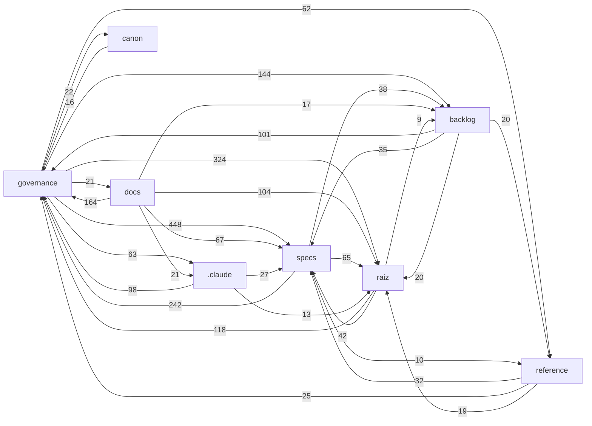

# MAPA DO PROJETO — SOT Harness

> **NÃO-NORMATIVO e REGENERÁVEL** (BL-019). Não é baseline (INV-09), não substitui o [CATALOGO-OFICIAL](../../governance/CATALOGO-OFICIAL.md) — que segue como locator autoritativo — e não fecha decisão aberta (CONS-01). Em conflito, vale o documento de origem.
>
> Regenerar: `python scripts/build_map.py` · Verificar defasagem: `python scripts/build_map.py --check`

Gerado em **2026-10-17** · digest `c7eb1c49f8355119` · **320** documentos · **3902** arestas doc→doc · fontes: `scripts/check_refs.py`, `scripts/backlog_triggers.py`

## 1. Camadas (por diretório)

| Área | Docs | Função | Mais referenciados |
|---|---:|---|---|
| **raiz** | 7 | entradas: ROADMAP, atomic-spec, AGENTS, GLOSSARIO, README | [ROADMAP.md](../../ROADMAP.md) (191) · [atomic-spec.md](../../atomic-spec.md) (115) · [AGENTS.md](../../AGENTS.md) (82) |
| **governance** | 176 | autoridade normativa: Constituição, RULES, CATALOGO, atas DHR, emendas EUA | [RULES.md](../../governance/RULES.md) (246) · [CATALOGO-OFICIAL.md](../../governance/CATALOGO-OFICIAL.md) (100) · [DHR-EUA-E04_Ata_Homologacao_Heranca_Delta.md](../../governance/DHR-EUA-E04_Ata_Homologacao_Heranca_Delta.md) (71) |
| **canon** | 9 | modelos canônicos BASELINED (CHM/CEM/CEE/GMC/SDD/PPQ/SAS/CR) | [CEM-001-canonical-evidence-model.md](../../canon/CEM-001-canonical-evidence-model.md) (102) · [CCM-001-canonical-conviction-model.md](../../canon/CCM-001-canonical-conviction-model.md) (89) · [CHM-001-canonical-hypothesis-model.md](../../canon/CHM-001-canonical-hypothesis-model.md) (87) |
| **specs** | 43 | Specs por feature (plan.md + checks.md) e specs de agente | [SPEC-002/plan.md](../../specs/features/SPEC-002/plan.md) (124) · [SPEC-001/plan.md](../../specs/features/SPEC-001/plan.md) (123) · [SPEC-003/plan.md](../../specs/features/SPEC-003/plan.md) (98) |
| **backlog** | 6 | RMR-001 e backlogs (gatilhos de ativação) | [RMR-001_Painel_Backlog.md](../../backlog/RMR-001_Painel_Backlog.md) (174) · [BL-018-RISK-AGENT-backlog.md](../../backlog/BL-018-RISK-AGENT-backlog.md) (21) · [BL-016-MC-SKL-001-encaminhamento.md](../../backlog/BL-016-MC-SKL-001-encaminhamento.md) (14) |
| **reference** | 28 | referências externas não-normativas (camadas, master contracts) | [MC-COG-001_Master_Contract_Camada_Cognicao.md](../../reference/camadas/MC-COG-001_Master_Contract_Camada_Cognicao.md) (25) · [MC-RAG-001_Master_Contract_Camada_RAG.md](../../reference/camadas/MC-RAG-001_Master_Contract_Camada_RAG.md) (14) · [SOT-RISK-MASTER-001_Consolidado.md](../../reference/SOT-RISK-MASTER-001_Consolidado.md) (8) |
| **rag** | 5 | chunks de conhecimento por agente | [synthesis.knowledge.md](../../rag/synthesis.knowledge.md) (3) |
| **.claude** | 12 | agentes e skills do Claude Code | [especificador.md](../../.claude/agents/especificador.md) (45) · [revisor.md](../../.claude/agents/revisor.md) (43) · [SKILL.md](../../.claude/skills/SKILL.md) (2) |
| **docs** | 29 | documentação histórica e de arranque (não essencial à operação) | [MATRIZ-WORKFLOW-SPEC.md](../../docs/MATRIZ-WORKFLOW-SPEC.md) (9) · [INDICE-AGENTES.md](../../docs/agentes/INDICE-AGENTES.md) (9) · [PARECER-RISK-AGENT-auditoria-semantica.md](../../docs/arranque/PARECER-RISK-AGENT-auditoria-semantica.md) (3) |
| **RETOMADA** | 1 | material de retomada (GEH-001) | [GEH-001_Guia_Agente_Especificacoes_Harness.md](../../RETOMADA/GEH-001_Guia_Agente_Especificacoes_Harness.md) (39) |
| **.clinerules** | 4 | regras Cline | [sot-rag.md](../../.clinerules/sot-rag.md) (2) · [sot-schemas.md](../../.clinerules/sot-schemas.md) (2) · [sot-map.md](../../.clinerules/sot-map.md) (1) |

## 2. Dependências entre camadas

Seta A → B = documentos de A referenciam documentos de B (só pares com ≥ 8 referências).

## 3. Hubs — IDs mais referenciados

| ID | Documentos que citam | Definido em |
|---|---:|---|
| `INV-07` | 174 | [governance/RULES.md](../../governance/RULES.md) |
| `SPEC-002` | 121 | [specs/features/SPEC-002/plan.md](../../specs/features/SPEC-002/plan.md) |
| `SPEC-001` | 109 | [specs/features/SPEC-001/plan.md](../../specs/features/SPEC-001/plan.md) |
| `SPEC-003` | 95 | [specs/features/SPEC-003/plan.md](../../specs/features/SPEC-003/plan.md) |
| `INV-09` | 94 | [governance/RULES.md](../../governance/RULES.md) |
| `SPEC-006` | 77 | [ROADMAP.md](../../ROADMAP.md) |
| `RULE-ECC-01` | 76 | [governance/RULES.md](../../governance/RULES.md) |
| `SPEC-004` | 72 | [specs/features/SPEC-004/plan.md](../../specs/features/SPEC-004/plan.md) |
| `EUA-E04` | 71 | [governance/DHR-EUA-E04_Ata_Homologacao_Heranca_Delta.md](../../governance/DHR-EUA-E04_Ata_Homologacao_Heranca_Delta.md) |
| `INV-05` | 69 | [governance/RULES.md](../../governance/RULES.md) |
| `SPEC-020` | 67 | [specs/features/SPEC-020/plan.md](../../specs/features/SPEC-020/plan.md) |
| `RULE-MET-01` | 65 | [governance/RULES.md](../../governance/RULES.md) |
| `SPEC-019` | 61 | [specs/features/SPEC-019/plan.md](../../specs/features/SPEC-019/plan.md) |
| `INV-04` | 54 | [governance/RULES.md](../../governance/RULES.md) |
| `RULE-EPI` | 54 | [governance/RULES.md](../../governance/RULES.md) |
| `SPEC-005` | 52 | [specs/features/SPEC-005/plan.md](../../specs/features/SPEC-005/plan.md) |
| `SPEC-014` | 51 | [ROADMAP.md](../../ROADMAP.md) |
| `SPEC-018` | 51 | [ROADMAP.md](../../ROADMAP.md) |
| `BL-017` | 48 | [backlog/RMR-001_Painel_Backlog.md](../../backlog/RMR-001_Painel_Backlog.md) |
| `RULE-ECC-04` | 47 | [governance/RULES.md](../../governance/RULES.md) |
| `INV-03` | 46 | [governance/RULES.md](../../governance/RULES.md) |
| `RULE-MECH-01` | 46 | [governance/RULES.md](../../governance/RULES.md) |
| `RULE-HV` | 45 | [governance/RULES.md](../../governance/RULES.md) |
| `SPEC-010` | 44 | [ROADMAP.md](../../ROADMAP.md) |
| `RULE-ECC-02` | 43 | [governance/RULES.md](../../governance/RULES.md) |

## 4. Cadeia de Specs

| Spec | Estado | Plano | Docs que citam |
|---|---|---|---:|
| `SPEC-001` | **Homologada** | [specs/features/SPEC-001/plan.md](../../specs/features/SPEC-001/plan.md) | 109 |
| `SPEC-002` | **Homologada** | [specs/features/SPEC-002/plan.md](../../specs/features/SPEC-002/plan.md) | 121 |
| `SPEC-003` | **Homologada** | [specs/features/SPEC-003/plan.md](../../specs/features/SPEC-003/plan.md) | 95 |
| `SPEC-004` | **Homologada** | [specs/features/SPEC-004/plan.md](../../specs/features/SPEC-004/plan.md) | 72 |
| `SPEC-005` | **Homologada** | [specs/features/SPEC-005/plan.md](../../specs/features/SPEC-005/plan.md) | 52 |
| `SPEC-006` | **Homologada** | [specs/features/SPEC-006/plan.md](../../specs/features/SPEC-006/plan.md) | 77 |
| `SPEC-007` | Indicativa (não aberta) | — | 36 |
| `SPEC-008` | Indicativa (não aberta) | — | 28 |
| `SPEC-009` | Indicativa (não aberta) | — | 26 |
| `SPEC-010` | Indicativa (não aberta) | — | 44 |
| `SPEC-011` | Indicativa (não aberta) | — | 6 |
| `SPEC-012` | Indicativa (não aberta) | — | 6 |
| `SPEC-013` | Indicativa (não aberta) | — | 8 |
| `SPEC-014` | Indicativa (não aberta) | — | 51 |
| `SPEC-015` | Indicativa (não aberta) | — | 24 |
| `SPEC-016` | Indicativa (não aberta) | — | 17 |
| `SPEC-017` | Indicativa (não aberta) | — | 4 |
| `SPEC-018` | Indicativa (não aberta) | — | 51 |
| `SPEC-019` | **Homologada** | [specs/features/SPEC-019/plan.md](../../specs/features/SPEC-019/plan.md) | 61 |
| `SPEC-020` | **Homologada** | [specs/features/SPEC-020/plan.md](../../specs/features/SPEC-020/plan.md) | 67 |
| `SPEC-021` | **Homologada** | [specs/features/SPEC-021/plan.md](../../specs/features/SPEC-021/plan.md) | 40 |
| `SPEC-022` | Indicativa (não aberta) | — | 8 |
| `SPEC-023` | Indicativa (não aberta) | — | 4 |
| `SPEC-024` | Indicativa (não aberta) | — | 9 |
| `SPEC-025` | Indicativa (não aberta) | — | 27 |
| `SPEC-026` | Indicativa (não aberta) | — | 3 |
| `SPEC-027` | Indicativa (não aberta) | — | 0 |
| `SPEC-028` | Indicativa (não aberta) | — | 0 |
| `SPEC-029` | Indicativa (não aberta) | — | 0 |
| `SPEC-030` | Indicativa (não aberta) | — | 0 |
| `SPEC-031` | Indicativa (não aberta) | — | 0 |
| `SPEC-032` | Indicativa (não aberta) | — | 1 |
| `SPEC-033` | Indicativa (não aberta) | — | 0 |
| `SPEC-034` | Indicativa (não aberta) | — | 0 |
| `SPEC-035` | Indicativa (não aberta) | — | 0 |
| `SPEC-036` | Indicativa (não aberta) | — | 2 |
| `SPEC-037` | Indicativa (não aberta) | — | 1 |
| `SPEC-038` | **Homologada** | [specs/features/SPEC-038/plan.md](../../specs/features/SPEC-038/plan.md) | 29 |
| `SPEC-039` | Indicativa (não aberta) | — | 8 |
| `SPEC-040` | Indicativa (não aberta) | — | 11 |
| `SPEC-041` | Indicativa (não aberta) | — | 12 |
| `SPEC-042` | Indicativa (não aberta) | — | 12 |
| `SPEC-043` | Indicativa (não aberta) | — | 4 |
| `SPEC-044` | Indicativa (não aberta) | — | 7 |
| `SPEC-045` | Indicativa (não aberta) | — | 7 |
| `SPEC-046` | **Homologada** | [specs/features/SPEC-046/plan.md](../../specs/features/SPEC-046/plan.md) | 26 |
| `SPEC-047` | Indicativa (não aberta) | — | 6 |

## 5. Backlog e integridade

- **Backlog (RMR-001):** ATIVADOS = nenhum · disparados sem registro = 2 · verificação manual = 5 itens (`python scripts/backlog_triggers.py`).
- **Referências (check_refs):** ERRO=0 · WARN=3 · INFO=194 (históricos congelados) — `python scripts/check_refs.py`.

## 6. Documentos sem referência de entrada

Nenhum outro documento cita por caminho, por ID resolvido ou pela chave do arquivo (ex.: `CHM-001`). Só arquivos `.md` são varridos: referências vindas de CI, JSON ou schemas não contam. Candidatos a revisão de higiene (RPIR) — **não** significa lixo.

- [.claude/commands/update-spec.md](../../.claude/commands/update-spec.md) — Update SOT Agent Spec
- [.claude/commands/validate-harness.md](../../.claude/commands/validate-harness.md) — Validate SOT Harness
- [.claude/skills/sot-especificador-pap001/SKILL.md](../../.claude/skills/sot-especificador-pap001/SKILL.md) — MISSÃO: PRODUZIR O PAP-001
- [.claude/skills/update-harness.md](../../.claude/skills/update-harness.md) — Update SOT Harness from Source Document
- [.claude/skills/validate-sot-spec.md](../../.claude/skills/validate-sot-spec.md) — Validate SOT Agent Spec
- [governance/DHR-SPEC002-001_Ata_Homologacao_Abertura_SPEC-002.md](../../governance/DHR-SPEC002-001_Ata_Homologacao_Abertura_SPEC-002.md) — DHR-SPEC002-001 — Ata de Homologação — Abertura da SPEC-002 (Evidence & Evidence Provenance Harness)
- [governance/ERRATUM-SPEC019-001_PROPOSTA.md](../../governance/ERRATUM-SPEC019-001_PROPOSTA.md) — ERRATUM-SPEC019-001 — Correção aditiva do status de L-001 na SPEC-019 homologada (PROPOSTA)
- [governance/EUA-E19a_Restauracao_Signal_Package_PROPOSTA.md](../../governance/EUA-E19a_Restauracao_Signal_Package_PROPOSTA.md) — EUA-E19a — Restauração Semântica do "Signal Package" (fronteira) + TMP interno (PROPOSTA)
- [governance/propostas/AUDITOR-EXTERNO/PROPOSTA-AUTOMACAO-B_GitHub-Action.md](../../governance/propostas/AUDITOR-EXTERNO/PROPOSTA-AUTOMACAO-B_GitHub-Action.md) — PROPOSTA — Automação do Auditor Externo por GitHub Action (caminho B)
- [governance/propostas/SPEC-002/ERRATUM-SPEC002-001_Aditivo_PROPOSTO.md](../../governance/propostas/SPEC-002/ERRATUM-SPEC002-001_Aditivo_PROPOSTO.md) — [ERRATUM-PROPOSTO — NÃO APLICADO] ERRATUM-SPEC002-001 — Erratum ADITIVO único (auditoria semântica SPEC-002: itens 1, 2, 3)
- [rag/elliott-wave.knowledge.md](../../rag/elliott-wave.knowledge.md) — RAG — Elliott Wave Specialist Knowledge Base
- [rag/fibonacci.knowledge.md](../../rag/fibonacci.knowledge.md) — RAG — Fibonacci Validator Knowledge Base
- [rag/ict.knowledge.md](../../rag/ict.knowledge.md) — RAG — ICT Specialist Knowledge Base
- [rag/smc.knowledge.md](../../rag/smc.knowledge.md) — RAG — SMC Specialist Knowledge Base
- [reference/externo/MASTER — MARKET DATA, ORDER FLOW E INTEGRAÇÃO TRADINGVIEW.MD](../../reference/externo/MASTER%20%E2%80%94%20MARKET%20DATA%2C%20ORDER%20FLOW%20E%20INTEGRA%C3%87%C3%83O%20TRADINGVIEW.MD) — MASTER — MARKET DATA, ORDER FLOW E INTEGRAÇÃO TRADINGVIEW
- [specs/features/SPEC-046/research.md](../../specs/features/SPEC-046/research.md) — Dossiê de Pesquisa — SPEC-046 (companion — convenção de nome do gate determinístico)

## 7. Índice de documentos

`←` = documentos que o citam · `→` = documentos que ele cita.

### raiz

| Documento | Título | ← | → |
|---|---|---:|---:|
| [AGENTS.md](../../AGENTS.md) | AGENTS.md — SOT (Sistema Operacional de Trading) | 82 | 41 |
| [GLOSSARIO.md](../../GLOSSARIO.md) | GLOSSÁRIO OFICIAL — SOT | 33 | 13 |
| [HANDOFF.md](../../HANDOFF.md) | HANDOFF — SOT | 8 | 16 |
| [README.md](../../README.md) | SOT-Harness | 1 | 9 |
| [ROADMAP.md](../../ROADMAP.md) | roadmap.md — SOT: Road Map Sequencial de Especificação do Harness Cognitivo | 191 | 64 |
| [WORKFLOW.md](../../WORKFLOW.md) | WORKFLOW — Setup Operacional Canônico do SOT | 50 | 12 |
| [atomic-spec.md](../../atomic-spec.md) | atomic-spec.md — Unidade Atômica de Especificação do Harness Cognitivo do SOT | 115 | 34 |

### governance

| Documento | Título | ← | → |
|---|---|---:|---:|
| [ADR-CONFLUENCE-001-v3_Skills_Confluence_Architecture.md](../../governance/ADR-CONFLUENCE-001-v3_Skills_Confluence_Architecture.md) | HOMOLOGADO — ADR-CONFLUENCE-001 v3 | 12 | 0 |
| [ADR-MANAGER-001_Manager_Agent_Architecture.md](../../governance/ADR-MANAGER-001_Manager_Agent_Architecture.md) | ADR-MANAGER-001 — Manager Agent: Arquitetura Unificada de Orquestração | 33 | 1 |
| [ADR-MISSION-TYPES-001_Mission_Types.md](../../governance/ADR-MISSION-TYPES-001_Mission_Types.md) | ADR-MISSION-TYPES-001 — Tipos de Missão: Exploratória e de Validação | 4 | 1 |
| [AUDITORIA-ADIANTAMENTO-SLOTS-ROADMAP-2026-09-28.md](../../governance/AUDITORIA-ADIANTAMENTO-SLOTS-ROADMAP-2026-09-28.md) | AUDITORIA DE ADIANTAMENTO DE ABERTURA — Slots Indicativos do ROADMAP | 5 | 19 |
| [AUDITORIA-HIGIENE-SPECS-2026-10-01.md](../../governance/AUDITORIA-HIGIENE-SPECS-2026-10-01.md) | AUDITORIA DE HIGIENE DAS SPECS — 2026-10-01 | 3 | 15 |
| [AUDITORIA-REVISOR-MATURIDADE-2026-10-17.md](../../governance/AUDITORIA-REVISOR-MATURIDADE-2026-10-17.md) | Auditoria por testes do Revisor SOT — interpelação e adversarial — nível de m... | 6 | 4 |
| [AVALIACAO-MECANISMOS-REVISOR-2026-10-17.md](../../governance/AVALIACAO-MECANISMOS-REVISOR-2026-10-17.md) | Avaliação dos mecanismos (regras, guardrails, hooks, policy, determinísticos)... | 5 | 8 |
| [BL-012-DELTA_PROPOSTA.md](../../governance/BL-012-DELTA_PROPOSTA.md) | BL-012 (MC-COG-001) — Reavaliação do DELTA — [PROPOSTA] | 33 | 13 |
| [BRIEFING-DECISAO-I-001.md](../../governance/BRIEFING-DECISAO-I-001.md) | BRIEFING DE DECISÃO — I-001 ("Skills como unidades formais separadas?") | 4 | 16 |
| [CATALOGO-OFICIAL.md](../../governance/CATALOGO-OFICIAL.md) | CATÁLOGO OFICIAL — Estado e Baseline dos Artefatos (SOT) | 100 | 183 |
| [CIC-001_Inventario_Conformidade.md](../../governance/CIC-001_Inventario_Conformidade.md) | CIC-001 --- Inventario de Conformidade de Principios do SOT | 30 | 27 |
| [CLASSIFICACAO-COLISOES-BL010-011-012.md](../../governance/CLASSIFICACAO-COLISOES-BL010-011-012.md) | CLASSIFICAÇÃO DE COLISÕES — BL-010 / BL-011 / BL-012 (Master Contracts diferi... | 3 | 10 |
| [CONFLICT-MAP.md](../../governance/CONFLICT-MAP.md) | Conflict Map — SOT (Sistema Operacional de Trading) | 45 | 36 |
| [CONSTITUTION.md](../../governance/CONSTITUTION.md) | SOT Constitution — Sistema Operacional de Trading | 26 | 1 |
| [DHR-ADR-HOC003_Ata_Homologacao_HOC003.md](../../governance/DHR-ADR-HOC003_Ata_Homologacao_HOC003.md) | DHR-ADR-HOC003 — Ata de Homologação — Cluster HOC-003 (Auditoria Taxonômica 2... | 7 | 6 |
| [DHR-AGENTES-001_Ata_Separacao_Agentes_Construcao_e_Trading.md](../../governance/DHR-AGENTES-001_Ata_Separacao_Agentes_Construcao_e_Trading.md) | DHR-AGENTES-001 — Ata — Separação nominal dos agentes de Construção e dos age... | 10 | 9 |
| [DHR-ARQ-001_Ata_Unificacao_Manager_Conviction.md](../../governance/DHR-ARQ-001_Ata_Unificacao_Manager_Conviction.md) | DHR-ARQ-001 — Ata de Unificação: Manager Agent absorve o Conviction Engine (p... | 20 | 13 |
| [DHR-ARQ-002_Ata_Manager_Absorve_Synthesis.md](../../governance/DHR-ARQ-002_Ata_Manager_Absorve_Synthesis.md) | DHR-ARQ-002 — Ata de Unificação: Manager Agent absorve o Synthesis Agent (pro... | 18 | 17 |
| [DHR-ASSINATURA-001_Ata_Assinatura_por_Decisao_Registrada.md](../../governance/DHR-ASSINATURA-001_Ata_Assinatura_por_Decisao_Registrada.md) | DHR-ASSINATURA-001 — Ata — A assinatura de Andraus passa a ser a decisão regi... | 5 | 6 |
| [DHR-AUDIT-SPEC001-001_Ata_Sessao_Auditoria_PROPOSTA.md](../../governance/DHR-AUDIT-SPEC001-001_Ata_Sessao_Auditoria_PROPOSTA.md) | DHR-AUDIT-SPEC001-001 — Ata — Sessão de auditoria semântica da SPEC-001 (deci... | 8 | 7 |
| [DHR-AUDITOR-EXTERNO-001_Ata_Piloto_Controlado.md](../../governance/DHR-AUDITOR-EXTERNO-001_Ata_Piloto_Controlado.md) | DHR-AUDITOR-EXTERNO-001 — Ata — Auditor externo (GPT): piloto controlado, hie... | 10 | 5 |
| [DHR-AUDITOR-EXTERNO-002_Ata_Ativacao_e_Limites.md](../../governance/DHR-AUDITOR-EXTERNO-002_Ata_Ativacao_e_Limites.md) | DHR-AUDITOR-EXTERNO-002 — Ata — Ativação do canal do Auditor Externo (piloto)... | 3 | 9 |
| [DHR-AUDITOR-EXTERNO-003_Ata_Bot_Agendado_Oracle.md](../../governance/DHR-AUDITOR-EXTERNO-003_Ata_Bot_Agendado_Oracle.md) | DHR-AUDITOR-EXTERNO-003 — Ata — Bot agendado do Auditor Externo (Codex soment... | 5 | 9 |
| [DHR-AUDITOR-EXTERNO-004_Ata_Ratificacao_RPSA_e_AGENTS.md](../../governance/DHR-AUDITOR-EXTERNO-004_Ata_Ratificacao_RPSA_e_AGENTS.md) | DHR-AUDITOR-EXTERNO-004 — Ata — Ratificação da classificação RPSA das atas 00... | 4 | 12 |
| [DHR-AUDITOR-EXTERNO-005_Ata_Roteamento_de_Achados_Faixa_Dupla.md](../../governance/DHR-AUDITOR-EXTERNO-005_Ata_Roteamento_de_Achados_Faixa_Dupla.md) | DHR-AUDITOR-EXTERNO-005 — Ata — Roteamento determinístico de achados do Audit... | 2 | 5 |
| [DHR-AUDITOR-EXTERNO-006_Ata_Erratum_AGENTS_I-001.md](../../governance/DHR-AUDITOR-EXTERNO-006_Ata_Erratum_AGENTS_I-001.md) | DHR-AUDITOR-EXTERNO-006 — Ata — Erratum do `AGENTS.md` §7 (I-001 já FECHADA) ... | 1 | 6 |
| [DHR-AUDITOR-EXTERNO-007_Ata_Pausa_do_Auditor_e_Reforco_do_Revisor.md](../../governance/DHR-AUDITOR-EXTERNO-007_Ata_Pausa_do_Auditor_e_Reforco_do_Revisor.md) | DHR-AUDITOR-EXTERNO-007 — Ata — Pausa do Auditor Externo e reforço do Revisor... | 4 | 6 |
| [DHR-AUDITOR-EXTERNO-008_Ata_Reforco_do_Revisor.md](../../governance/DHR-AUDITOR-EXTERNO-008_Ata_Reforco_do_Revisor.md) | DHR-AUDITOR-EXTERNO-008 — Ata — Reforço do Revisor interno (pacote de evidênc... | 4 | 5 |
| [DHR-AUDITOR-EXTERNO-009_Ata_Gate_Fundido_Classe_D_do_Revisor.md](../../governance/DHR-AUDITOR-EXTERNO-009_Ata_Gate_Fundido_Classe_D_do_Revisor.md) | DHR-AUDITOR-EXTERNO-009 — Ata — Gate fundido (Classe D) como ferramenta ofici... | 16 | 7 |
| [DHR-AUDITOR-EXTERNO-010_Ata_Proposta_Emenda_do_Revisor_Gate_Fundido.md](../../governance/DHR-AUDITOR-EXTERNO-010_Ata_Proposta_Emenda_do_Revisor_Gate_Fundido.md) | DHR-AUDITOR-EXTERNO-010 — Ata — Proposta de emenda do `.claude/agents/revisor... | 2 | 6 |
| [DHR-AUDITOR-EXTERNO-011_Ata_Aplicacao_da_Emenda_do_Revisor.md](../../governance/DHR-AUDITOR-EXTERNO-011_Ata_Aplicacao_da_Emenda_do_Revisor.md) | DHR-AUDITOR-EXTERNO-011 — Ata — Aplicação ao `.claude/agents/revisor.md` da e... | 1 | 7 |
| [DHR-AUDITOR-EXTERNO-012_Ata_Correcao_Passo8_Revisor_I001_L001.md](../../governance/DHR-AUDITOR-EXTERNO-012_Ata_Correcao_Passo8_Revisor_I001_L001.md) | DHR-AUDITOR-EXTERNO-012 — Ata — Correção do Passo 8 do `.claude/agents/reviso... | 1 | 9 |
| [DHR-AUDITOR-EXTERNO-013_Ata_Novas_Verificacoes_D_no_Gate_do_Revisor.md](../../governance/DHR-AUDITOR-EXTERNO-013_Ata_Novas_Verificacoes_D_no_Gate_do_Revisor.md) | DHR-AUDITOR-EXTERNO-013 — Ata — Novas verificações determinísticas (Classe D)... | 1 | 7 |
| [DHR-AUDITOR-EXTERNO-014_Ata_Revisor_Modelo_e_Metodo_V2.md](../../governance/DHR-AUDITOR-EXTERNO-014_Ata_Revisor_Modelo_e_Metodo_V2.md) | DHR-AUDITOR-EXTERNO-014 — Ata — Revisor SOT: modelo elevado e Passo 4-ter (in... | 15 | 7 |
| [DHR-AUDITOR-EXTERNO-015_Ata_Brechas_de_Ferramenta_e_Medicao_do_Revisor.md](../../governance/DHR-AUDITOR-EXTERNO-015_Ata_Brechas_de_Ferramenta_e_Medicao_do_Revisor.md) | DHR-AUDITOR-EXTERNO-015 — Ata — Brechas de ferramenta dos subagentes de revis... | 14 | 6 |
| [DHR-AUDITOR-EXTERNO-016_Ata_Fusao_dos_Subagentes_Antigos_no_Revisor.md](../../governance/DHR-AUDITOR-EXTERNO-016_Ata_Fusao_dos_Subagentes_Antigos_no_Revisor.md) | DHR-AUDITOR-EXTERNO-016 — Ata — Fusão do que era útil dos subagentes de 1ª ge... | 15 | 9 |
| [DHR-AUDITOR-EXTERNO-017_Ata_Deteccao_Deterministica_e_Guarda_do_Revisor.md](../../governance/DHR-AUDITOR-EXTERNO-017_Ata_Deteccao_Deterministica_e_Guarda_do_Revisor.md) | DHR-AUDITOR-EXTERNO-017 — Ata — Detectores determinísticos adicionais no gate... | 4 | 10 |
| [DHR-AUDITOR-EXTERNO-018_Ata_Guarda_Pos_Revisor_no_Orquestrador.md](../../governance/DHR-AUDITOR-EXTERNO-018_Ata_Guarda_Pos_Revisor_no_Orquestrador.md) | DHR-AUDITOR-EXTERNO-018 — Ata — Guarda pós-Revisor no Orquestrador (hook Stop... | 1 | 5 |
| [DHR-BL008-001_Ata_Homologacao_Mapa_Auditoria_SPEC-001.md](../../governance/DHR-BL008-001_Ata_Homologacao_Mapa_Auditoria_SPEC-001.md) | DHR-BL008-001 — Ata de Homologação — Mapa de Auditoria da SPEC-001 (BL-008) | 9 | 11 |
| [DHR-BL009-001_Ata_Homologacao_Mapa_Auditoria_SAS-001.md](../../governance/DHR-BL009-001_Ata_Homologacao_Mapa_Auditoria_SAS-001.md) | DHR-BL009-001 — Ata de Homologação — Mapa de Auditoria do SAS-001 (BL-009) | 3 | 6 |
| [DHR-BL010-011-012-001_Ata_Homologacao_Classificacao_Colisoes.md](../../governance/DHR-BL010-011-012-001_Ata_Homologacao_Classificacao_Colisoes.md) | DHR-BL010-011-012-001 — Ata de Homologação — Classificação de Colisões (MC-RA... | 6 | 4 |
| [DHR-BL012-001_Ata_Encerramento_BL-012_Delta.md](../../governance/DHR-BL012-001_Ata_Encerramento_BL-012_Delta.md) | DHR-BL012-001 — Ata — Encerramento do BL-012 (MC-COG-001) após reavaliação do... | 6 | 15 |
| [DHR-CIC-001_Ata_Homologacao_CIC-001.md](../../governance/DHR-CIC-001_Ata_Homologacao_CIC-001.md) | DHR-CIC-001 — Ata de Homologação do CIC-001 v1.0 | 5 | 2 |
| [DHR-CLASSE-MECH-001_Ata_Homologacao_Classe_Mecanismo.md](../../governance/DHR-CLASSE-MECH-001_Ata_Homologacao_Classe_Mecanismo.md) | DHR-CLASSE-MECH-001 — Ata de Homologação — Taxonomia de Classe/Mecanismo de I... | 12 | 20 |
| [DHR-DEC-001_Ata_Decisoes_QA5_RISKCONV_RISKARR.md](../../governance/DHR-DEC-001_Ata_Decisoes_QA5_RISKCONV_RISKARR.md) | DHR-DEC-001 — Ata de Decisões — Q-A5, RISK-CONV-001, RISK-ARR-LOC-001, DIV co... | 17 | 14 |
| [DHR-DEC-002_Ata_QA9_Regime_Temporal.md](../../governance/DHR-DEC-002_Ata_QA9_Regime_Temporal.md) | DHR-DEC-002 — Ata de Decisão — Q-A9 (dimensão do regime de mercado) → dimensã... | 9 | 10 |
| [DHR-DEC-003_Ata_Decisoes_SPEC038_BL.md](../../governance/DHR-DEC-003_Ata_Decisoes_SPEC038_BL.md) | DHR-DEC-003 — Ata de Decisões — SPEC-038 (TVMCP-001), BL-002/012/027/028/029/... | 23 | 9 |
| [DHR-DEC-004_Ata_Decisoes_BL017_DATASRC_MASTER.md](../../governance/DHR-DEC-004_Ata_Decisoes_BL017_DATASRC_MASTER.md) | DHR-DEC-004 — Ata de Decisões — BL-017, SPEC-038-DATASRC-001, MASTER Market D... | 17 | 12 |
| [DHR-DIV-001_Ata_Varredura_Termos_Legados_Canon.md](../../governance/DHR-DIV-001_Ata_Varredura_Termos_Legados_Canon.md) | DHR-DIV-001 — Ata de Varredura DIV: termos legados em documentos CANON BASELINED | 7 | 12 |
| [DHR-DOCSYNC-001_Ata_Homologacao_Sincronizacao_Documental.md](../../governance/DHR-DOCSYNC-001_Ata_Homologacao_Sincronizacao_Documental.md) | DHR-DOCSYNC-001 — Ata de Homologação — Detector de Sincronização Documental +... | 2 | 13 |
| [DHR-DOCSYNC-002_Ata_Homologacao_Encaminhamento_Residuais.md](../../governance/DHR-DOCSYNC-002_Ata_Homologacao_Encaminhamento_Residuais.md) | DHR-DOCSYNC-002 — Ata de Homologação — Encaminhamento dos Residuais de DHR-DO... | 5 | 20 |
| [DHR-ECC05-001_Ata_Homologacao_Pesquisa_Multi_Lente.md](../../governance/DHR-ECC05-001_Ata_Homologacao_Pesquisa_Multi_Lente.md) | DHR-ECC05-001 — Ata de Homologação — Pesquisa Multi-Lente (RULE-ECC-05) | 9 | 8 |
| [DHR-ECC06-001_Ata_Homologacao_Pesquisa_Repositorios.md](../../governance/DHR-ECC06-001_Ata_Homologacao_Pesquisa_Repositorios.md) | DHR-ECC06-001 — Ata de Homologação — RULE-ECC-06: Pesquisa em repositórios se... | 8 | 7 |
| [DHR-ERRATA-001_Ata_Errata_SPEC001_SPEC005_BL003.md](../../governance/DHR-ERRATA-001_Ata_Errata_SPEC001_SPEC005_BL003.md) | DHR-ERRATA-001 — Ata — Errata aditivas (SPEC-001 âncora SAS-001; SPEC-005 est... | 9 | 11 |
| [DHR-EUA-E04_Ata_Homologacao_Heranca_Delta.md](../../governance/DHR-EUA-E04_Ata_Homologacao_Heranca_Delta.md) | DHR-EUA-E04 — Ata de Homologação da Emenda EUA-E04 (Bloco Herança/Delta) | 71 | 5 |
| [DHR-EUA-E05_Ata_Homologacao_Epistemic_Check.md](../../governance/DHR-EUA-E05_Ata_Homologacao_Epistemic_Check.md) | DHR-EUA-E05 — Ata de Homologação da Emenda EUA-E05 (Epistemic Check) | 30 | 7 |
| [DHR-EUA-E06_Ata_Homologacao_Camada_Semantica.md](../../governance/DHR-EUA-E06_Ata_Homologacao_Camada_Semantica.md) | DHR-EUA-E06 — Ata de Homologação da Emenda EUA-E06 (Camada Semântica) | 14 | 6 |
| [DHR-EUA-E07_Ata_Homologacao_Camada_Ontologica.md](../../governance/DHR-EUA-E07_Ata_Homologacao_Camada_Ontologica.md) | DHR-EUA-E07 — Ata de Homologação da Emenda EUA-E07 (Camada Ontológica) | 10 | 5 |
| [DHR-EUA-E08_Ata_Homologacao_Camada_Inquerito.md](../../governance/DHR-EUA-E08_Ata_Homologacao_Camada_Inquerito.md) | DHR-EUA-E08 — Ata de Homologação da Emenda EUA-E08 (Camada de Inquérito) | 10 | 5 |
| [DHR-EUA-E09_Ata_Homologacao_Camada_Causal.md](../../governance/DHR-EUA-E09_Ata_Homologacao_Camada_Causal.md) | DHR-EUA-E09 — Ata de Homologação da Emenda EUA-E09 (Camada Causal) | 14 | 4 |
| [DHR-EUA-E10_Ata_Homologacao_Camada_Contrafactual.md](../../governance/DHR-EUA-E10_Ata_Homologacao_Camada_Contrafactual.md) | DHR-EUA-E10 — Ata de Homologação da Emenda EUA-E10 (Camada Contrafactual) | 11 | 5 |
| [DHR-EUA-E11_Ata_Homologacao_Camada_Incerteza.md](../../governance/DHR-EUA-E11_Ata_Homologacao_Camada_Incerteza.md) | DHR-EUA-E11 — Ata de Homologação da Emenda EUA-E11 (Camada de Incerteza) | 12 | 4 |
| [DHR-EUA-E12_Ata_Homologacao_Camada_Probabilistica.md](../../governance/DHR-EUA-E12_Ata_Homologacao_Camada_Probabilistica.md) | DHR-EUA-E12 — Ata de Homologação da Emenda EUA-E12 (Camada Probabilística) | 11 | 5 |
| [DHR-EUA-E13_Ata_Homologacao_Camada_Decisional.md](../../governance/DHR-EUA-E13_Ata_Homologacao_Camada_Decisional.md) | DHR-EUA-E13 — Ata de Homologação da Emenda EUA-E13 (Camada Decisional) | 13 | 4 |
| [DHR-EUA-E14_Ata_Homologacao_Camada_Metacognicao.md](../../governance/DHR-EUA-E14_Ata_Homologacao_Camada_Metacognicao.md) | DHR-EUA-E14 — Ata de Homologação da Emenda EUA-E14 (Camada Metacognição) | 11 | 5 |
| [DHR-EUA-E15_Ata_Homologacao_Redesignacao_Piloto_SPEC-001.md](../../governance/DHR-EUA-E15_Ata_Homologacao_Redesignacao_Piloto_SPEC-001.md) | DHR-EUA-E15 — Ata de Homologação da Redesignação do Piloto de Incorporação (S... | 20 | 6 |
| [DHR-EUA-E16_Ata_Homologacao_Sincronizacao_Agentes.md](../../governance/DHR-EUA-E16_Ata_Homologacao_Sincronizacao_Agentes.md) | DHR-EUA-E16 — Ata de Homologação da Sincronização dos Agentes + RPSA | 25 | 6 |
| [DHR-EUA-E17_Ata_Homologacao_Reposicionamento_Specs_Governanca_Harness.md](../../governance/DHR-EUA-E17_Ata_Homologacao_Reposicionamento_Specs_Governanca_Harness.md) | DHR-EUA-E17 — Ata de Homologação: Reposicionamento das Specs de Governança do... | 23 | 15 |
| [DHR-EUA-E18_Ata_Homologacao_Reducao_Vies_Sincronizacao_SpecLean.md](../../governance/DHR-EUA-E18_Ata_Homologacao_Reducao_Vies_Sincronizacao_SpecLean.md) | DHR-EUA-E18 — Ata de Homologação: Redução de Viés e Uso Sincronizado da Spec-... | 27 | 16 |
| [DHR-EUA-E19_Ata_Homologacao_Economia_Tokens_Camada_Meta.md](../../governance/DHR-EUA-E19_Ata_Homologacao_Economia_Tokens_Camada_Meta.md) | DHR-EUA-E19 — Ata de Homologação: Economia de Tokens na Camada Meta (Roteamen... | 23 | 11 |
| [DHR-EUA-E19a_Ata_Homologacao_Restauracao_Signal_Package.md](../../governance/DHR-EUA-E19a_Ata_Homologacao_Restauracao_Signal_Package.md) | DHR-EUA-E19a — Ata de Homologação — Restauração Semântica do Signal Package | 25 | 10 |
| [DHR-EUA-E20_Ata_Homologacao_Fase_RISK.md](../../governance/DHR-EUA-E20_Ata_Homologacao_Fase_RISK.md) | DHR-EUA-E20 — Ata de Homologação: FASE RISK (6 macro-slots indicativos da fam... | 21 | 18 |
| [DHR-EUA-E21_Ata_Homologacao_Especificacao_Emergente.md](../../governance/DHR-EUA-E21_Ata_Homologacao_Especificacao_Emergente.md) | DHR-EUA-E21 — Ata de Homologação: Especificação Emergente (ROADMAP como direç... | 41 | 16 |
| [DHR-EUA-E22_Ata_Homologacao_Manutencao_Mapa_Projeto.md](../../governance/DHR-EUA-E22_Ata_Homologacao_Manutencao_Mapa_Projeto.md) | DHR-EUA-E22 — Ata de Homologação: Manutenção obrigatória do Mapa do Projeto (... | 15 | 14 |
| [DHR-EUA-E23_Ata_Homologacao_Manager_Unificado.md](../../governance/DHR-EUA-E23_Ata_Homologacao_Manager_Unificado.md) | DHR-EUA-E23 — Ata de Homologação: Manager Agent Unificado (3 Specs sob "Manag... | 17 | 13 |
| [DHR-HOD-001_Ata_Homologacao_Higiene_Documental.md](../../governance/DHR-HOD-001_Ata_Homologacao_Higiene_Documental.md) | DHR-HOD-001 — Ata de Homologação do Plano de Higiene e Organização Documental... | 3 | 5 |
| [DHR-I001-001_Ata_Homologacao_Fechamento_I-001.md](../../governance/DHR-I001-001_Ata_Homologacao_Fechamento_I-001.md) | DHR-I001-001 — Ata de Homologação — Fechamento de I-001 (Skills como unidades... | 12 | 8 |
| [DHR-MAN-001_Ata_Homologacao_Mapa_Arquitetura_Normativa.md](../../governance/DHR-MAN-001_Ata_Homologacao_Mapa_Arquitetura_Normativa.md) | DHR-MAN-001 — Ata de Homologação do MAN-001 (Mapa da Arquitetura Normativa) | 4 | 3 |
| [DHR-MC-COG-001_Ata_Admissao_Backlog_BL-012.md](../../governance/DHR-MC-COG-001_Ata_Admissao_Backlog_BL-012.md) | DHR-MC-COG-001 — Ata de Homologação da Admissão ao Backlog (BL-012 · Camada d... | 3 | 5 |
| [DHR-MC-EXP-001_Ata_Admissao_Backlog_BL-011.md](../../governance/DHR-MC-EXP-001_Ata_Admissao_Backlog_BL-011.md) | DHR-MC-EXP-001 — Ata de Homologação da Admissão ao Backlog (BL-011 · Camada d... | 3 | 7 |
| [DHR-MC-GOV-001_Ata_Admissao_Backlog_BL-013.md](../../governance/DHR-MC-GOV-001_Ata_Admissao_Backlog_BL-013.md) | DHR-MC-GOV-001 — Ata de Homologação da Admissão ao Backlog (BL-013 · Camada d... | 4 | 7 |
| [DHR-MC-LRN-001_Ata_Admissao_Backlog_BL-015.md](../../governance/DHR-MC-LRN-001_Ata_Admissao_Backlog_BL-015.md) | DHR-MC-LRN-001 — Ata de Homologação da Admissão ao Backlog (BL-015 · Camada d... | 3 | 7 |
| [DHR-MC-RAG-001_Ata_Admissao_Backlog_BL-010.md](../../governance/DHR-MC-RAG-001_Ata_Admissao_Backlog_BL-010.md) | DHR-MC-RAG-001 — Ata de Homologação da Admissão ao Backlog (BL-010 · Camada RAG) | 4 | 7 |
| [DHR-MC-SKL-001_Ata_Admissao_Backlog_BL-016.md](../../governance/DHR-MC-SKL-001_Ata_Admissao_Backlog_BL-016.md) | DHR-MC-SKL-001 — Ata de Homologação da Admissão ao Backlog (BL-016 · Camada d... | 5 | 7 |
| [DHR-PAP-001-A_Adendo_Rehomologacao_PE-PR-PAP-001_v1.1.md](../../governance/DHR-PAP-001-A_Adendo_Rehomologacao_PE-PR-PAP-001_v1.1.md) | DHR-PAP-001-A — Adendo de Re-Homologação do PE-PR-PAP-001 v1.1 | 14 | 8 |
| [DHR-PAP-001-B_Ata_Homologacao_PAP-001.md](../../governance/DHR-PAP-001-B_Ata_Homologacao_PAP-001.md) | DHR-PAP-001-B — Ata de Homologação do PAP-001 v1.1 | 14 | 4 |
| [DHR-PAP-001-C_Ata_Homologacao_VPD_RMR-001.md](../../governance/DHR-PAP-001-C_Ata_Homologacao_VPD_RMR-001.md) | DHR-PAP-001-C — Ata de Homologação: VPD (Bloco 7), Wiring RMR-001 e Painel RM... | 14 | 6 |
| [DHR-PAP-001_Ata_Homologacao_Camada_Principios.md](../../governance/DHR-PAP-001_Ata_Homologacao_Camada_Principios.md) | DHR-PAP-001 — Ata de Homologação da Camada de Princípios do SOT | 14 | 8 |
| [DHR-PCC-001_Ata_Homologacao_Fase1_Continuidade_Contexto.md](../../governance/DHR-PCC-001_Ata_Homologacao_Fase1_Continuidade_Contexto.md) | DHR-PCC-001 — Ata — Fase 1 do PCC-001: continuidade de contexto entre sessões... | 8 | 10 |
| [DHR-PCC-002_Ata_Fase2_Detector_e_Hooks_do_Handoff.md](../../governance/DHR-PCC-002_Ata_Fase2_Detector_e_Hooks_do_Handoff.md) | DHR-PCC-002 — Ata — Fase 2 do PCC-001: detector, hooks e CI informativo do HA... | 4 | 4 |
| [DHR-PRINC-BID-001_Ata_Homologacao_Heranca_Bidirecional.md](../../governance/DHR-PRINC-BID-001_Ata_Homologacao_Heranca_Bidirecional.md) | DHR-PRINC-BID-001 — Ata de Homologação — Herança Principiológica Bidirecional | 9 | 10 |
| [DHR-PROV-WEB-001_Ata_Provisao_Pesquisa_Web_Especificador.md](../../governance/DHR-PROV-WEB-001_Ata_Provisao_Pesquisa_Web_Especificador.md) | DHR-PROV-WEB-001 — Ata de Homologação — Provisão de Pesquisa Web ao Especific... | 25 | 2 |
| [DHR-REG-001_Ata_Homologacao_Registro_Familias_Cognitivas.md](../../governance/DHR-REG-001_Ata_Homologacao_Registro_Familias_Cognitivas.md) | DHR-REG-001 — Ata de Homologação — Registro Físico das 11 Famílias Cognitivas... | 12 | 16 |
| [DHR-ROTEAMENTO-001_Ata_Decisoes_Roteamento_de_Modelos_Onda0.md](../../governance/DHR-ROTEAMENTO-001_Ata_Decisoes_Roteamento_de_Modelos_Onda0.md) | DHR-ROTEAMENTO-001 — Ata — Decisões D1–D6 sobre roteamento de modelos dos age... | 8 | 8 |
| [DHR-RPSA-001_Ata_Automacao_dos_Carimbos_RPSA.md](../../governance/DHR-RPSA-001_Ata_Automacao_dos_Carimbos_RPSA.md) | DHR-RPSA-001 — Ata — Automação determinística dos carimbos RPSA e sincronizaç... | 4 | 10 |
| [DHR-RPSA-002_Ata_Classificacao_RPSA_Automatica.md](../../governance/DHR-RPSA-002_Ata_Classificacao_RPSA_Automatica.md) | DHR-RPSA-002 — Ata — Classificação RPSA automática após a aprovação de Andraus | 2 | 6 |
| [DHR-SES-001_Ata_Homologacao_SES-001_EUA-E03.md](../../governance/DHR-SES-001_Ata_Homologacao_SES-001_EUA-E03.md) | DHR-SES-001 — Ata de Homologação: SES-001, EUA-E03 e Emenda de Inversões Cont... | 6 | 5 |
| [DHR-SPEC002-001_Ata_Homologacao_Abertura_SPEC-002.md](../../governance/DHR-SPEC002-001_Ata_Homologacao_Abertura_SPEC-002.md) | DHR-SPEC002-001 — Ata de Homologação — Abertura da SPEC-002 (Evidence & Evide... | 0 | 13 |
| [DHR-SPEC002-001_Ata_Homologacao_SPEC-002.md](../../governance/DHR-SPEC002-001_Ata_Homologacao_SPEC-002.md) | DHR-SPEC002-001 — Ata de Homologação — SPEC-002 v1.0 (Evidence & Evidence Pro... | 12 | 10 |
| [DHR-SPEC002-VERBATIM-001_Ata_Decisao_Captura_Verbatim_Diferida.md](../../governance/DHR-SPEC002-VERBATIM-001_Ata_Decisao_Captura_Verbatim_Diferida.md) | DHR-SPEC002-VERBATIM-001 — Ata de Decisão — Captura Verbatim Diferida (RULE-E... | 1 | 7 |
| [DHR-SPEC003-001_Ata_Homologacao_SPEC-003.md](../../governance/DHR-SPEC003-001_Ata_Homologacao_SPEC-003.md) | DHR-SPEC003-001 — Ata de Homologação — SPEC-003 v1.5 (Conviction Vector, Evid... | 22 | 20 |
| [DHR-SPEC004-001_Ata_Homologacao_Abertura_SPEC-004.md](../../governance/DHR-SPEC004-001_Ata_Homologacao_Abertura_SPEC-004.md) | DHR-SPEC004-001 — Ata de Homologação — Abertura da SPEC-004 (Cognitive Blackb... | 10 | 11 |
| [DHR-SPEC004-002_Ata_Homologacao_SPEC-004.md](../../governance/DHR-SPEC004-002_Ata_Homologacao_SPEC-004.md) | DHR-SPEC004-002 — Ata de Homologação — SPEC-004 (Cognitive Blackboard Protoco... | 7 | 10 |
| [DHR-SPEC004-003_Ata_Homologacao_Emenda_v1.2_SPEC-004.md](../../governance/DHR-SPEC004-003_Ata_Homologacao_Emenda_v1.2_SPEC-004.md) | DHR-SPEC004-003 — Ata de Homologação — Emenda v1.2 da SPEC-004 (Cognitive Bla... | 12 | 10 |
| [DHR-SPEC005-001_Ata_Homologacao_Abertura_SPEC-005.md](../../governance/DHR-SPEC005-001_Ata_Homologacao_Abertura_SPEC-005.md) | DHR-SPEC005-001 — Ata de Homologação — Abertura da SPEC-005 (Cognitive Event ... | 11 | 12 |
| [DHR-SPEC005-002_Ata_Homologacao_SPEC-005.md](../../governance/DHR-SPEC005-002_Ata_Homologacao_SPEC-005.md) | DHR-SPEC005-002 — Ata de Homologação — SPEC-005 (Cognitive Event Bus) v1.0 — ... | 12 | 11 |
| [DHR-SPEC006-001_Ata_Homologacao_Abertura_SPEC-006.md](../../governance/DHR-SPEC006-001_Ata_Homologacao_Abertura_SPEC-006.md) | DHR-SPEC006-001 — Ata de Homologação — Abertura da SPEC-006 (Cognitive Knowle... | 18 | 11 |
| [DHR-SPEC006-PEND-001_Ata_BL029_EmEspera_e_Emenda_atomic-spec_S3.md](../../governance/DHR-SPEC006-PEND-001_Ata_BL029_EmEspera_e_Emenda_atomic-spec_S3.md) | DHR-SPEC006-PEND-001 — Ata — BL-029 `Em espera` e emenda Minor ao `atomic-spe... | 5 | 11 |
| [DHR-SPEC019-001_Ata_Homologacao_SPEC-019.md](../../governance/DHR-SPEC019-001_Ata_Homologacao_SPEC-019.md) | DHR-SPEC019-001 — Ata de Homologação — SPEC-019 v1.0 (Harness Governance & Ev... | 17 | 6 |
| [DHR-SPEC020-001_Ata_Homologacao_SPEC-020.md](../../governance/DHR-SPEC020-001_Ata_Homologacao_SPEC-020.md) | DHR-SPEC020-001 — Ata de Homologação — SPEC-020 v1.0 (Harness Evaluation Spec... | 11 | 9 |
| [DHR-SPEC021-001_Ata_Homologacao_SPEC-021.md](../../governance/DHR-SPEC021-001_Ata_Homologacao_SPEC-021.md) | DHR-SPEC021-001 — Ata de Homologação — SPEC-021 v1.0 (Harness Score / Maturit... | 8 | 7 |
| [DHR-SPEC038-001_Ata_Homologacao_Abertura_SPEC-038.md](../../governance/DHR-SPEC038-001_Ata_Homologacao_Abertura_SPEC-038.md) | DHR-SPEC038-001 — Ata de Homologação — Abertura da SPEC-038 (Trading Analysis... | 9 | 14 |
| [DHR-SPEC038-002_Ata_Homologacao_SPEC-038.md](../../governance/DHR-SPEC038-002_Ata_Homologacao_SPEC-038.md) | DHR-SPEC038-002 — Ata de Homologação — SPEC-038 (Trading Analysis Tool Harnes... | 10 | 13 |
| [DHR-SPEC046-001_Ata_Homologacao_Abertura_SPEC-046.md](../../governance/DHR-SPEC046-001_Ata_Homologacao_Abertura_SPEC-046.md) | DHR-SPEC046-001 — Ata de Homologação — Abertura da SPEC-046 (Spec-Time Contex... | 7 | 12 |
| [DHR-SPEC046-002_Ata_Homologacao_SPEC-046.md](../../governance/DHR-SPEC046-002_Ata_Homologacao_SPEC-046.md) | DHR-SPEC046-002 — Ata de Homologação — SPEC-046 v1.0 (Spec-Time Context Cachi... | 6 | 15 |
| [DHR-SPEC046-003_Ata_Homologacao_SPEC-046_v1.1.md](../../governance/DHR-SPEC046-003_Ata_Homologacao_SPEC-046_v1.1.md) | DHR-SPEC046-003 — Ata de Homologação — SPEC-046 v1.1 (Emenda: Caching Inter-S... | 4 | 8 |
| [DHR-TAX-001_Ata_Alinhamento_Taxonomico.md](../../governance/DHR-TAX-001_Ata_Alinhamento_Taxonomico.md) | DHR-TAX-001 — Ata de Alinhamento Taxonômico — 4 Correções de Bloqueadores Crí... | 11 | 9 |
| [DHR-VERBATIM-SRC-001_Ata_Homologacao_Captura_Verbatim.md](../../governance/DHR-VERBATIM-SRC-001_Ata_Homologacao_Captura_Verbatim.md) | DHR-VERBATIM-SRC-001 — Ata de Homologação — Captura Verbatim de Fonte (RULE-E... | 12 | 10 |
| [DHR-WF-001_Ata_Homologacao_WORKFLOW_Soberano.md](../../governance/DHR-WF-001_Ata_Homologacao_WORKFLOW_Soberano.md) | DHR-WF-001 — Ata de Homologação — WORKFLOW.md soberano na raiz + conformidade... | 9 | 8 |
| [DHR-WF-002_Ata_Homologacao_WORKFLOW_v2.md](../../governance/DHR-WF-002_Ata_Homologacao_WORKFLOW_v2.md) | DHR-WF-002 — Ata de Homologação — WORKFLOW.md v2.0 (decisões sobre o Dossiê d... | 5 | 8 |
| [EMENDA-SPEC001-001_hierarchy_role_PROPOSTA.md](../../governance/EMENDA-SPEC001-001_hierarchy_role_PROPOSTA.md) | [HOMOLOGADO — aplicado em 2026-10-05, DHR-AUDIT-SPEC001-001] EMENDA-SPEC001-0... | 1 | 15 |
| [ERRATUM-SPEC001-001_Ancora_SAS-001_6.10.md](../../governance/ERRATUM-SPEC001-001_Ancora_SAS-001_6.10.md) | ERRATUM-SPEC001-001 — Âncora de fonte: SAS-001 §6.7 → §6.10 (metadados de tra... | 3 | 5 |
| [ERRATUM-SPEC001-002_Auditoria_Semantica_Aditivo_PROPOSTO.md](../../governance/ERRATUM-SPEC001-002_Auditoria_Semantica_Aditivo_PROPOSTO.md) | [HOMOLOGADO — aplicado em 2026-10-05, DHR-AUDIT-SPEC001-001] ERRATUM-SPEC001-... | 3 | 21 |
| [ERRATUM-SPEC005-001_Estado_BL-008.md](../../governance/ERRATUM-SPEC005-001_Estado_BL-008.md) | ERRATUM-SPEC005-001 — Estado do BL-008: `Absorvido`, não `ATIVADO` — erratum ... | 1 | 13 |
| [ERRATUM-SPEC019-001_PROPOSTA.md](../../governance/ERRATUM-SPEC019-001_PROPOSTA.md) | ERRATUM-SPEC019-001 — Correção aditiva do status de L-001 na SPEC-019 homolog... | 0 | 9 |
| [ERRATUM-SPEC020-001_Fechamento_tool_correctness.md](../../governance/ERRATUM-SPEC020-001_Fechamento_tool_correctness.md) | ERRATUM-SPEC020-001 — Fechamento da dimensão B "tool correctness" (BL-017) — ... | 2 | 8 |
| [EUA-E04_Heranca_Delta_PROPOSTA.md](../../governance/EUA-E04_Heranca_Delta_PROPOSTA.md) | EUA-E04 — Bloco "Herança / Delta" no atomic-spec §8 (PROPOSTA) | 3 | 6 |
| [EUA-E05_Epistemic_Check_PROPOSTA.md](../../governance/EUA-E05_Epistemic_Check_PROPOSTA.md) | EUA-E05 — Epistemic Check no atomic-spec §11 (PROPOSTA) | 3 | 8 |
| [EUA-E06_Camada_Semantica_PROPOSTA.md](../../governance/EUA-E06_Camada_Semantica_PROPOSTA.md) | EUA-E06 — Camada Semântica: Terminologia Concorrente + RULE-SEM (PROPOSTA) | 3 | 8 |
| [EUA-E07_Camada_Ontologica_PROPOSTA.md](../../governance/EUA-E07_Camada_Ontologica_PROPOSTA.md) | EUA-E07 — Camada Ontológica: RULE-ONT (observacional vs teórico) + nó N10 (PR... | 2 | 9 |
| [EUA-E08_Camada_Inquerito_PROPOSTA.md](../../governance/EUA-E08_Camada_Inquerito_PROPOSTA.md) | EUA-E08 — Camada de Inquérito: RULE-INQ (classificação de questão + evidência... | 2 | 8 |
| [EUA-E09_Camada_Causal_PROPOSTA.md](../../governance/EUA-E09_Camada_Causal_PROPOSTA.md) | EUA-E09 — Camada Causal: RULE-CAU (mecanismo obrigatório + regime + guard pós... | 2 | 8 |
| [EUA-E10_Camada_Contrafactual_PROPOSTA.md](../../governance/EUA-E10_Camada_Contrafactual_PROPOSTA.md) | EUA-E10 — Camada Contrafactual: RULE-CTF (baseline + intervenção mínima + ant... | 2 | 8 |
| [EUA-E11_Camada_Incerteza_PROPOSTA.md](../../governance/EUA-E11_Camada_Incerteza_PROPOSTA.md) | EUA-E11 — Camada de Incerteza: RULE-UNC (localizar/tipificar + não-contaminaç... | 2 | 9 |
| [EUA-E12_Camada_Probabilistica_PROPOSTA.md](../../governance/EUA-E12_Camada_Probabilistica_PROPOSTA.md) | EUA-E12 — Camada Probabilística: RULE-PRB (evento bem-formado + não quantific... | 2 | 9 |
| [EUA-E13_Camada_Decisional_PROPOSTA.md](../../governance/EUA-E13_Camada_Decisional_PROPOSTA.md) | EUA-E13 — Camada Decisional: RULE-DEC (decisão≠execução+autoridade · condicio... | 2 | 12 |
| [EUA-E14_Camada_Metacognicao_PROPOSTA.md](../../governance/EUA-E14_Camada_Metacognicao_PROPOSTA.md) | EUA-E14 — Camada Metacognição: RULE-MET (honestidade/não-fabricação · abstenç... | 2 | 12 |
| [EUA-E15_Redesignacao_Piloto_SPEC-001_PROPOSTA.md](../../governance/EUA-E15_Redesignacao_Piloto_SPEC-001_PROPOSTA.md) | EUA-E15 — Redesignação do Piloto de Incorporação para SPEC-001 (auditoria ret... | 4 | 18 |
| [EUA-E16_Sincronizacao_Agentes_PROPOSTA.md](../../governance/EUA-E16_Sincronizacao_Agentes_PROPOSTA.md) | EUA-E16 — Sincronização das Definições dos Agentes + Regra Permanente de Sinc... | 3 | 12 |
| [EUA-E17_Reposicionamento_Specs_Governanca_Harness_PROPOSTA.md](../../governance/EUA-E17_Reposicionamento_Specs_Governanca_Harness_PROPOSTA.md) | EUA-E17 — Reposicionamento das Specs de Governança do Harness no ROADMAP (PRO... | 2 | 23 |
| [EUA-E18_Reducao_Vies_Sincronizacao_SpecLean_PROPOSTA.md](../../governance/EUA-E18_Reducao_Vies_Sincronizacao_SpecLean_PROPOSTA.md) | EUA-E18 — Redução de Viés e Uso Sincronizado da Spec-Lean entre Especificador... | 2 | 19 |
| [EUA-E19_Economia_Tokens_Camada_Meta_PROPOSTA.md](../../governance/EUA-E19_Economia_Tokens_Camada_Meta_PROPOSTA.md) | EUA-E19 — Economia de Tokens na Camada Meta (Especificador/Revisor): Roteamen... | 2 | 15 |
| [EUA-E19a_Restauracao_Signal_Package_PROPOSTA.md](../../governance/EUA-E19a_Restauracao_Signal_Package_PROPOSTA.md) | EUA-E19a — Restauração Semântica do "Signal Package" (fronteira) + TMP intern... | 0 | 16 |
| [EUA-E20_Fase_RISK_Slots_PROPOSTA.md](../../governance/EUA-E20_Fase_RISK_Slots_PROPOSTA.md) | EUA-E20 — FASE RISK: slots-macro indicativos da família RISK-SPEC (PROPOSTA) | 1 | 17 |
| [EUA-E21_Especificacao_Emergente_Pesquisa_Web_PROPOSTA.md](../../governance/EUA-E21_Especificacao_Emergente_Pesquisa_Web_PROPOSTA.md) | EUA-E21 — Especificação Emergente: o ROADMAP não pré-determina Specs nem quan... | 1 | 21 |
| [EUA-E22_Manutencao_Mapa_Projeto_PROPOSTA.md](../../governance/EUA-E22_Manutencao_Mapa_Projeto_PROPOSTA.md) | EUA-E22 — Manutenção obrigatória do Mapa do Projeto (BL-019) por todos os age... | 1 | 12 |
| [EUA-E23_Manager_Unificado_SPEC008_SPEC015_PROPOSTA.md](../../governance/EUA-E23_Manager_Unificado_SPEC008_SPEC015_PROPOSTA.md) | EUA-E23 — Manager Agent Unificado: simetria camadas×agentes e quantidade de S... | 1 | 15 |
| [GPR-001_Guia_Principios_Relacoes_SOT.md](../../governance/GPR-001_Guia_Principios_Relacoes_SOT.md) | GPR-001 — Guia de Princípios, Relações e Organicidade do SOT | 59 | 12 |
| [HOD-001_Plano_Higiene_Organizacao_Documental_PROPOSTA.md](../../governance/HOD-001_Plano_Higiene_Organizacao_Documental_PROPOSTA.md) | HOD-001 — Plano de Higiene e Organização Documental (PROPOSTA) | 21 | 11 |
| [MAN-001_Mapa_Arquitetura_Normativa_PROPOSTA.md](../../governance/MAN-001_Mapa_Arquitetura_Normativa_PROPOSTA.md) | MAN-001 — Mapa da Arquitetura Normativa (PROPOSTA) | 42 | 18 |
| [MANUAL_UNIVERSAL_ENGENHARIA_DE_PRINCIPIOS_AGENTICOS.md](../../governance/MANUAL_UNIVERSAL_ENGENHARIA_DE_PRINCIPIOS_AGENTICOS.md) | MANUAL UNIVERSAL DE ENGENHARIA DE PRINCÍPIOS, PONDERAÇÃO E DINÂMICA PARA SIST... | 1 | 0 |
| [MAPA-AUDITORIA-SAS-001.md](../../governance/MAPA-AUDITORIA-SAS-001.md) | Mapa de Auditoria do SAS-001 (BL-009) — reavaliação sob SES-001 §59/§60 | 2 | 15 |
| [MAPA-AUDITORIA-SPEC-001.md](../../governance/MAPA-AUDITORIA-SPEC-001.md) | Mapa de Auditoria da SPEC-001 (BL-008) — versão canônica completa (14 linhas) | 8 | 32 |
| [MAPA-AUDITORIA-SPEC-001_LINHAS-ADICIONAIS_RASCUNHO.md](../../governance/MAPA-AUDITORIA-SPEC-001_LINHAS-ADICIONAIS_RASCUNHO.md) | Mapa de Auditoria da SPEC-001 (BL-008) — linhas adicionais EUA-E21 e EUA-E22 ... | 8 | 16 |
| [PAP-001_Protocolo_Adesao_Progressiva_Principios.md](../../governance/PAP-001_Protocolo_Adesao_Progressiva_Principios.md) | PAP-001 — Protocolo de Adesão Progressiva da Camada de Princípios do SOT | 23 | 17 |
| [PCC-001_Plano_Continuidade_Contexto_Build_PROPOSTA.md](../../governance/PCC-001_Plano_Continuidade_Contexto_Build_PROPOSTA.md) | PCC-001 — Plano de Continuidade de Contexto e Memória entre Sessões do Orques... | 19 | 13 |
| [PE-PR-PAP-001_Prompts_Especificador_Revisor_PAP001.md](../../governance/PE-PR-PAP-001_Prompts_Especificador_Revisor_PAP001.md) | PE-PR-PAP-001 — Prompts de Invocação do Especificador e do Revisor para o PAP... | 9 | 13 |
| [PP-PAP-001_Pacote_Partida_Protocolo_Adesao_Progressiva.md](../../governance/PP-PAP-001_Pacote_Partida_Protocolo_Adesao_Progressiva.md) | PP-PAP-001 — Pacote de Partida do PAP-001 | 12 | 5 |
| [RCH-001_Registro_Ciclos_Hygiene.md](../../governance/RCH-001_Registro_Ciclos_Hygiene.md) | RCH-001 — Registro de Ciclos de Hygiene de Princípios | 19 | 22 |
| [RULES.md](../../governance/RULES.md) | Rules — SOT (Sistema Operacional de Trading) | 246 | 35 |
| [SES-001_Especializacao_Cognitiva_Trading.md](../../governance/SES-001_Especializacao_Cognitiva_Trading.md) | EMENDA SES-001 | 56 | 3 |
| [AGENTE-AUDITOR-EXTERNO.md](../../governance/propostas/AUDITOR-EXTERNO/AGENTE-AUDITOR-EXTERNO.md) | AGENTE AUDITOR EXTERNO — SOT (documento de instalação e instruções) | 2 | 11 |
| [BRIEFING-GPT_PROMPT.md](../../governance/propostas/AUDITOR-EXTERNO/BRIEFING-GPT_PROMPT.md) | BRIEFING-GPT — Instruções prontas para colar no Auditor Externo ("GPT") | 4 | 1 |
| [DIRETIVAS-AO-AUDITOR.md](../../governance/propostas/AUDITOR-EXTERNO/DIRETIVAS-AO-AUDITOR.md) | DIRETIVAS AO AUDITOR EXTERNO — instruções e postura (versionadas)  `[PROPOSTA... | 7 | 7 |
| [DOSSIE-PESQUISA.md](../../governance/propostas/AUDITOR-EXTERNO/DOSSIE-PESQUISA.md) | DOSSIÊ DE PESQUISA — Auditor Externo LLM ("GPT") para o SOT | 7 | 6 |
| [MANIFESTO-DE-ESCOPO_PROPOSTA.md](../../governance/propostas/AUDITOR-EXTERNO/MANIFESTO-DE-ESCOPO_PROPOSTA.md) | MANIFESTO DE ESCOPO — Auditor Externo LLM ("GPT") | 1 | 17 |
| [OPERACAO.md](../../governance/propostas/AUDITOR-EXTERNO/OPERACAO.md) | Operação do Auditor Externo (piloto) — `[PROPOSTA — NÃO NORMATIVO]` | 6 | 4 |
| [PROPOSTA-AUTOMACAO-B_GitHub-Action.md](../../governance/propostas/AUDITOR-EXTERNO/PROPOSTA-AUTOMACAO-B_GitHub-Action.md) | PROPOSTA — Automação do Auditor Externo por GitHub Action (caminho B) | 0 | 4 |
| [PROTOCOLO-AUDITOR-EXTERNO_PROPOSTA.md](../../governance/propostas/AUDITOR-EXTERNO/PROTOCOLO-AUDITOR-EXTERNO_PROPOSTA.md) | PROTOCOLO DO AUDITOR EXTERNO LLM ("GPT") — PROPOSTA | 4 | 18 |
| [INSTRUCOES-OPERACIONAIS-GPT.md](../../governance/propostas/AUDITOR-EXTERNO/kit/INSTRUCOES-OPERACIONAIS-GPT.md) | INSTRUÇÕES OPERACIONAIS DETERMINÍSTICAS — Auditor Externo (GPT)  `[PROPOSTA —... | 3 | 10 |
| [PROMPT-AUDITOR-CI.md](../../governance/propostas/AUDITOR-EXTERNO/kit/PROMPT-AUDITOR-CI.md) | PROMPT DO AUDITOR EXTERNO — modo bot (somente leitura) | 3 | 8 |
| [README-INSTALACAO.md](../../governance/propostas/AUDITOR-EXTERNO/kit/README-INSTALACAO.md) | Kit do Auditor Externo — instalação e acesso  `[PROPOSTA — NÃO HOMOLOGADO]` | 5 | 7 |
| [AUDITORIA-ROTEAMENTO-MODELOS_PROPOSTA.md](../../governance/propostas/ROTEAMENTO-MODELOS/AUDITORIA-ROTEAMENTO-MODELOS_PROPOSTA.md) | Auditoria de tarefas por criticidade e Dossiê de roteamento de modelos (camad... | 3 | 21 |
| [TELEMETRIA-ONDA0.md](../../governance/propostas/ROTEAMENTO-MODELOS/TELEMETRIA-ONDA0.md) | Telemetria manual — onda 0 de roteamento (rascunho, não normativo) | 3 | 3 |
| [ERRATUM-SPEC002-001_Aditivo_PROPOSTO.md](../../governance/propostas/SPEC-002/ERRATUM-SPEC002-001_Aditivo_PROPOSTO.md) | [ERRATUM-PROPOSTO — NÃO APLICADO] ERRATUM-SPEC002-001 — Erratum ADITIVO único... | 0 | 19 |
| [REAUDITORIA-SPEC002-001_PROPOSTA-CORRECOES.md](../../governance/propostas/SPEC-002/REAUDITORIA-SPEC002-001_PROPOSTA-CORRECOES.md) | REAUDITORIA-SPEC002-001 — Proposta de Correções — SPEC-002 | 1 | 6 |

### canon

| Documento | Título | ← | → |
|---|---|---:|---:|
| [CCM-001-canonical-conviction-model.md](../../canon/CCM-001-canonical-conviction-model.md) | CCM-001 — Canonical Conviction Model Specification | 89 | 6 |
| [CEE-001-cognitive-economy-efficiency-v2.0.md](../../canon/CEE-001-cognitive-economy-efficiency-v2.0.md) | CEE-001 — Cognitive Economy & Efficiency Specification | 82 | 4 |
| [CEM-001-canonical-evidence-model.md](../../canon/CEM-001-canonical-evidence-model.md) | CEM-001 — Canonical Evidence Model Specification | 102 | 2 |
| [CHM-001-canonical-hypothesis-model.md](../../canon/CHM-001-canonical-hypothesis-model.md) | CHM-001 — Canonical Hypothesis Model (consolidado) | 87 | 0 |
| [CR-001-compliance-record.md](../../canon/CR-001-compliance-record.md) | CR-001 — Compliance Record Specification (consolidado, Cap.6-8) | 8 | 0 |
| [GMC-001-governance-canonical-models.md](../../canon/GMC-001-governance-canonical-models.md) | GMC-001 — Canonical Models Governance Specification | 52 | 0 |
| [PPQ-001-project-process-quality.md](../../canon/PPQ-001-project-process-quality.md) | PPQ-001 — Especificação de Gestão de Projetos, Processos e Qualidade | 25 | 3 |
| [SAS-001-structural-agent-spec.md](../../canon/SAS-001-structural-agent-spec.md) | SAS-001 — Structural Agent Specification (consolidado) | 41 | 3 |
| [SDD-001-spec-driven-development.md](../../canon/SDD-001-spec-driven-development.md) | SDD-001 — Protocolo de Spec-Driven Development do ORYX AGENT | 12 | 0 |

### specs

| Documento | Título | ← | → |
|---|---|---:|---:|
| [elliott-wave.spec.md](../../specs/elliott-wave.spec.md) | Spec — Elliott Wave Specialist | 3 | 1 |
| [SPEC-001/checks.md](../../specs/features/SPEC-001/checks.md) | SPEC-001 — Hypothesis Harness — Verificação de Spec | 34 | 2 |
| [SPEC-001/plan.md](../../specs/features/SPEC-001/plan.md) | SPEC-001 — Hypothesis Harness | 123 | 9 |
| [DOSSIE-PESQUISA.md](../../specs/features/SPEC-002/DOSSIE-PESQUISA.md) | Dossiê de Pesquisa — SPEC-002 (Evidence & Evidence Provenance Harness) | 2 | 14 |
| [PROPOSTA-ABERTURA.md](../../specs/features/SPEC-002/PROPOSTA-ABERTURA.md) | Proposta de Abertura — SPEC-002: Evidence & Evidence Provenance Harness | 4 | 16 |
| [SPEC-002/checks.md](../../specs/features/SPEC-002/checks.md) | checks.md — Verificação de Spec da SPEC-002 (fase spec-first) | 3 | 9 |
| [SPEC-002/plan.md](../../specs/features/SPEC-002/plan.md) | SPEC-002 — Evidence & Evidence Provenance Harness | 124 | 17 |
| [research.md](../../specs/features/SPEC-002/research.md) | SPEC-002 — Evidence & Evidence Provenance Harness — DOSSIÊ DE PESQUISA (ABERT... | 14 | 19 |
| [SPEC-003/checks.md](../../specs/features/SPEC-003/checks.md) | checks.md — Verificação de Spec da SPEC-003 (fase spec-first) | 3 | 17 |
| [SPEC-003/plan.md](../../specs/features/SPEC-003/plan.md) | SPEC-003 — Conviction Vector, Evidence Fusion Engine & Conviction Engine | 98 | 24 |
| [research-Q-A9-regime.md](../../specs/features/SPEC-003/research-Q-A9-regime.md) | SPEC-003 — Q-A9: Dimensão do Regime de Mercado (WF-C04) — DOSSIÊ DE PESQUISA | 6 | 4 |
| [research.md](../../specs/features/SPEC-003/research.md) | SPEC-003 — Conviction Vector, Evidence Fusion Engine & Conviction Engine — DO... | 3 | 22 |
| [ABERTURA.md](../../specs/features/SPEC-004/ABERTURA.md) | Proposta de Abertura — SPEC-004: Cognitive Blackboard Protocol | 9 | 15 |
| [SPEC-004/checks.md](../../specs/features/SPEC-004/checks.md) | checks.md — Verificação de Spec da SPEC-004 (fase spec-first) | 2 | 12 |
| [SPEC-004/plan.md](../../specs/features/SPEC-004/plan.md) | SPEC-004 — Cognitive Blackboard Protocol | 72 | 21 |
| [research.md](../../specs/features/SPEC-004/research.md) | Dossiê de Pesquisa — SPEC-004: Cognitive Blackboard Protocol | 2 | 14 |
| [ABERTURA.md](../../specs/features/SPEC-005/ABERTURA.md) | Proposta de Abertura — SPEC-005: Cognitive Event Bus (slot ROADMAP §5, FASE 2) | 3 | 17 |
| [SPEC-005/checks.md](../../specs/features/SPEC-005/checks.md) | checks.md — Verificação de Spec da SPEC-005 (fase spec-first) | 2 | 11 |
| [SPEC-005/plan.md](../../specs/features/SPEC-005/plan.md) | SPEC-005 — Cognitive Event Bus | 52 | 22 |
| [research.md](../../specs/features/SPEC-005/research.md) | Dossiê de Pesquisa — SPEC-005: Cognitive Event Bus (slot ROADMAP §5, FASE 2) | 2 | 21 |
| [ABERTURA.md](../../specs/features/SPEC-006/ABERTURA.md) | Proposta de Abertura — SPEC-006: Cognitive Knowledge Graph (slot ROADMAP §6, ... | 2 | 17 |
| [research.md](../../specs/features/SPEC-006/research.md) | Dossiê de Pesquisa — SPEC-006: Cognitive Knowledge Graph (slot ROADMAP §6, FA... | 1 | 22 |
| [SPEC-019/checks.md](../../specs/features/SPEC-019/checks.md) | checks.md — Verificação de Spec da SPEC-019 (fase spec-first) | 1 | 8 |
| [SPEC-019/plan.md](../../specs/features/SPEC-019/plan.md) | SPEC-019 — Harness Governance & Evolution (+ Contrato de Herança Vertical) | 61 | 18 |
| [SPEC-020/checks.md](../../specs/features/SPEC-020/checks.md) | checks.md — Verificação de Spec da SPEC-020 (fase spec-first) | 2 | 7 |
| [SPEC-020/plan.md](../../specs/features/SPEC-020/plan.md) | SPEC-020 — Harness Evaluation Specification (núcleo A) | 67 | 20 |
| [research.md](../../specs/features/SPEC-020/research.md) | SPEC-020 — Harness Evaluation Specification (núcleo A) — DOSSIÊ DE PESQUISA (... | 1 | 15 |
| [SPEC-021/checks.md](../../specs/features/SPEC-021/checks.md) | checks.md — Verificação de Spec da SPEC-021 (fase spec-first) | 1 | 9 |
| [SPEC-021/plan.md](../../specs/features/SPEC-021/plan.md) | SPEC-021 — Harness Score / Maturity Model | 40 | 17 |
| [research.md](../../specs/features/SPEC-021/research.md) | SPEC-021 — Harness Score / Maturity Model — DOSSIÊ DE PESQUISA (ABERTURA) | 1 | 18 |
| [ABERTURA.md](../../specs/features/SPEC-038/ABERTURA.md) | Proposta de Abertura — SPEC-038: Trading Analysis Tool Harness | 6 | 18 |
| [SPEC-038/checks.md](../../specs/features/SPEC-038/checks.md) | SPEC-038 — Trading Analysis Tool Harness (Checks — verificação de spec) | 1 | 8 |
| [SPEC-038/plan.md](../../specs/features/SPEC-038/plan.md) | SPEC-038 — Trading Analysis Tool Harness (Plan) | 29 | 21 |
| [research.md](../../specs/features/SPEC-038/research.md) | Dossiê de Pesquisa — SPEC-038: Trading Analysis Tool Harness | 4 | 19 |
| [DOSSIE-PESQUISA.md](../../specs/features/SPEC-046/DOSSIE-PESQUISA.md) | Dossiê de Pesquisa — SPEC-046 (Grupo B: Caching de Spec-Time — Especificador/... | 3 | 9 |
| [PROPOSTA-ABERTURA.md](../../specs/features/SPEC-046/PROPOSTA-ABERTURA.md) | Proposta de Abertura — SPEC-046: Spec-Time Context Caching Harness (Grupo B —... | 4 | 21 |
| [SPEC-046/checks.md](../../specs/features/SPEC-046/checks.md) | checks.md — Verificação de Spec da SPEC-046 (fase spec-first) | 1 | 9 |
| [SPEC-046/plan.md](../../specs/features/SPEC-046/plan.md) | SPEC-046 — Spec-Time Context Caching Harness (Especificador/Revisor) | 26 | 23 |
| [research.md](../../specs/features/SPEC-046/research.md) | Dossiê de Pesquisa — SPEC-046 (companion — convenção de nome do gate determin... | 0 | 5 |
| [fibonacci.spec.md](../../specs/fibonacci.spec.md) | Spec — Fibonacci Validator | 3 | 1 |
| [ict.spec.md](../../specs/ict.spec.md) | Spec — ICT Specialist (Execution Intelligence) | 2 | 1 |
| [smc.spec.md](../../specs/smc.spec.md) | Spec — SMC Specialist (Institutional Intelligence) | 2 | 0 |
| [synthesis.spec.md](../../specs/synthesis.spec.md) | Spec — Synthesis Agent (Árbitro Final) | 7 | 2 |

### backlog

| Documento | Título | ← | → |
|---|---|---:|---:|
| [ANALISE-PRIORIZACAO-BACKLOG-2026-09-28.md](../../backlog/ANALISE-PRIORIZACAO-BACKLOG-2026-09-28.md) | ANÁLISE DE PRIORIZAÇÃO — Itens PENDENTES do Backlog (RMR-001) | 4 | 15 |
| [BL-016-MC-SKL-001-encaminhamento.md](../../backlog/BL-016-MC-SKL-001-encaminhamento.md) | BL-016 — Encaminhamento do MC-SKL-001 (Camada de Skills) após fechamento de I... | 14 | 14 |
| [BL-018-RISK-AGENT-backlog.md](../../backlog/BL-018-RISK-AGENT-backlog.md) | BL-018 — Risk Agent SOT (Família RISK-SPEC) | 21 | 17 |
| [BL-025-CACHE-ISS-001-analise.md](../../backlog/BL-025-CACHE-ISS-001-analise.md) | BL-025 — CACHE-ISS-001 — Análise Técnica Preparatória | 5 | 15 |
| [BL-034-OBSERVABILIDADE-LOGS-AGENTES-backlog.md](../../backlog/BL-034-OBSERVABILIDADE-LOGS-AGENTES-backlog.md) | BL-034 — Observabilidade e logs de agentes (master externo) — intake de backlog | 4 | 7 |
| [RMR-001_Painel_Backlog.md](../../backlog/RMR-001_Painel_Backlog.md) | RMR-001 — Painel Vivo de Backlog e Rastreabilidade de Ativação | 174 | 104 |

### reference

| Documento | Título | ← | → |
|---|---|---:|---:|
| [ANALISE-REVISAO-EXTERNA-SPEC003-2026-10-02.md](../../reference/ANALISE-REVISAO-EXTERNA-SPEC003-2026-10-02.md) | ANÁLISE CRÍTICA DA REVISÃO EXTERNA DA SPEC-003 (LLM externo) — 2026-10-02 | 3 | 11 |
| [PESQUISA-ENFORCEMENT-SCORE-INVALIDACAO-2026-10-02.md](../../reference/PESQUISA-ENFORCEMENT-SCORE-INVALIDACAO-2026-10-02.md) | PESQUISA — Enforcement / Score / Invalidação / Ponto de Interceptação de Polí... | 2 | 14 |
| [PESQUISA-WORKFLOW-TRADING-2026-10-01.md](../../reference/PESQUISA-WORKFLOW-TRADING-2026-10-01.md) | PESQUISA — Estado da Arte para Evolução do WORKFLOW Operacional do SOT | 7 | 8 |
| [RESPOSTAS-WORKFLOW-2026-10-01.md](../../reference/RESPOSTAS-WORKFLOW-2026-10-01.md) | RESPOSTAS DE ANDRAUS — evolução do WORKFLOW.md (2026-10-01) | 4 | 6 |
| [SOT-RISK-MASTER-001_Consolidado.md](../../reference/SOT-RISK-MASTER-001_Consolidado.md) | SOT-RISK-MASTER-001 — Master Document: Risk Agent SOT | 8 | 15 |
| [CAMADA APRENDIZADO.MD](../../reference/camadas/CAMADA%20APRENDIZADO.MD) | MC-LRN-001 — MASTER CONTRACT DA CAMADA DE LEARNING | 7 | 0 |
| [CAMADA CONFRACTUAL.MD](../../reference/camadas/CAMADA%20CONFRACTUAL.MD) | MASTER SPEC | 2 | 0 |
| [CAMADA DE CAUSALIDADE.MD](../../reference/camadas/CAMADA%20DE%20CAUSALIDADE.MD) | MASTER SPEC — CAMADA CAUSAL DO UNIVERSO COGNITIVO DO LLM | 2 | 0 |
| [CAMADA DE HARNESS.MD](../../reference/camadas/CAMADA%20DE%20HARNESS.MD) | HCH-001 | 3 | 0 |
| [CAMADA DECISIONAL.MD](../../reference/camadas/CAMADA%20DECISIONAL.MD) | MASTER SPEC | 2 | 0 |
| [CAMADA EPISTÊMICA.MD](../../reference/camadas/CAMADA%20EPIST%C3%8AMICA.MD) | MEG-001 | 3 | 0 |
| [CAMADA GOVERNANÇA CONHECIMENTO.MD](../../reference/camadas/CAMADA%20GOVERNAN%C3%87A%20CONHECIMENTO.MD) | MC-GOV-001 — MASTER CONTRACT DA CAMADA DE GOVERNANÇA | 3 | 0 |
| [CAMADA INCERTEZA.MD](../../reference/camadas/CAMADA%20INCERTEZA.MD) | MASTER SPEC | 2 | 0 |
| [CAMADA INQUÉRITO.MD](../../reference/camadas/CAMADA%20INQU%C3%89RITO.MD) | MIQG-001 | 2 | 0 |
| [CAMADA MEMÓRIA.MD](../../reference/camadas/CAMADA%20MEM%C3%93RIA.MD) | MC-EXP-001 — MASTER CONTRACT DA CAMADA DE EXPERIÊNCIA E MEMÓRIA | 4 | 0 |
| [CAMADA METACOGNIÇÃO.MD](../../reference/camadas/CAMADA%20METACOGNI%C3%87%C3%83O.MD) | MASTER DOCUMENTO | 3 | 0 |
| [CAMADA ONTOLÓGICA.MD](../../reference/camadas/CAMADA%20ONTOL%C3%93GICA.MD) | MASTER SPEC — CAMADA ONTOLÓGICA DO UNIVERSO COGNITIVO DO LLM | 2 | 0 |
| [CAMADA PRINCIPIOLÓGICA.MD](../../reference/camadas/CAMADA%20PRINCIPIOL%C3%93GICA.MD) | CMHP-001 | 5 | 0 |
| [CAMADA PROBABILISTICA.MD](../../reference/camadas/CAMADA%20PROBABILISTICA.MD) | MASTER SPEC | 2 | 0 |
| [CAMADA SEMÂNTICA.MD](../../reference/camadas/CAMADA%20SEM%C3%82NTICA.MD) | MASTER SPEC — CAMADA SEMÂNTICA DO UNIVERSO COGNITIVO DO LLM | 2 | 0 |
| [CAMADAS SKILLS.MD](../../reference/camadas/CAMADAS%20SKILLS.MD) | MC-SKL-001 | 6 | 0 |
| [MC-COG-001_Master_Contract_Camada_Cognicao.md](../../reference/camadas/MC-COG-001_Master_Contract_Camada_Cognicao.md) | MC-COG-001 — Master Contract da Camada de Cognição | 25 | 0 |
| [MC-RAG-001_Master_Contract_Camada_RAG.md](../../reference/camadas/MC-RAG-001_Master_Contract_Camada_RAG.md) | MC-RAG-001 — Master Contract da Camada RAG | 14 | 0 |
| [CACHING SOT.MD](../../reference/externo/CACHING%20SOT.MD) | CACHING SOT | 8 | 3 |
| [MASTER — MARKET DATA, ORDER FLOW E INTEGRAÇÃO TRADINGVIEW.MD](../../reference/externo/MASTER%20%E2%80%94%20MARKET%20DATA%2C%20ORDER%20FLOW%20E%20INTEGRA%C3%87%C3%83O%20TRADINGVIEW.MD) | MASTER — MARKET DATA, ORDER FLOW E INTEGRAÇÃO TRADINGVIEW | 0 | 2 |
| [TUTORIAL-PINE-BACKTEST-CALIBRACAO-SOT.md](../../reference/externo/TUTORIAL-PINE-BACKTEST-CALIBRACAO-SOT.md) | Tutorial técnico — Pine Script, backtest e calibração como suplemento do SOT | 6 | 14 |
| [TUTORIAL-TRADINGVIEW-MCP-CLAUDE-CODE.md](../../reference/externo/TUTORIAL-TRADINGVIEW-MCP-CLAUDE-CODE.md) | Tutorial técnico — Claude Code lendo e manipulando o TradingView (MCP + CDP) | 6 | 8 |
| [Uso de Logs por Agentes de IA.MD](../../reference/externo/Uso%20de%20Logs%20por%20Agentes%20de%20IA.MD) | MASTER DOCUMENT | 3 | 0 |

### rag

| Documento | Título | ← | → |
|---|---|---:|---:|
| [elliott-wave.knowledge.md](../../rag/elliott-wave.knowledge.md) | RAG — Elliott Wave Specialist Knowledge Base | 0 | 0 |
| [fibonacci.knowledge.md](../../rag/fibonacci.knowledge.md) | RAG — Fibonacci Validator Knowledge Base | 0 | 0 |
| [ict.knowledge.md](../../rag/ict.knowledge.md) | RAG — ICT Specialist Knowledge Base | 0 | 0 |
| [smc.knowledge.md](../../rag/smc.knowledge.md) | RAG — SMC Specialist Knowledge Base | 0 | 0 |
| [synthesis.knowledge.md](../../rag/synthesis.knowledge.md) | RAG — Synthesis Agent Knowledge Base | 3 | 2 |

### .claude

| Documento | Título | ← | → |
|---|---|---:|---:|
| [especificador.md](../../.claude/agents/especificador.md) | VOCÊ É O ESPECIFICADOR PRINCIPAL DO SOT | 45 | 57 |
| [revisor.md](../../.claude/agents/revisor.md) | Write, Edit e Bash são INTENCIONALMENTE AUSENTES. | 43 | 57 |
| [update-spec.md](../../.claude/commands/update-spec.md) | Update SOT Agent Spec | 0 | 0 |
| [validate-harness.md](../../.claude/commands/validate-harness.md) | Validate SOT Harness | 0 | 3 |
| [SKILL.md](../../.claude/skills/SKILL.md) | SOT Harness — Referência Mestre de Especificação | 2 | 4 |
| [SKILL.md](../../.claude/skills/harness-eval/SKILL.md) | Harness Eval | 1 | 3 |
| [GLOSSARY.md](../../.claude/skills/harness-eval/references/GLOSSARY.md) | Harness Eval — plain-language glossary | 2 | 0 |
| [PROTOCOL.md](../../.claude/skills/harness-eval/references/PROTOCOL.md) | Harness Evaluation Protocol | 1 | 3 |
| [judge-prompts.md](../../.claude/skills/harness-eval/references/judge-prompts.md) | Judge spawn prompts | 1 | 0 |
| [SKILL.md](../../.claude/skills/sot-especificador-pap001/SKILL.md) | MISSÃO: PRODUZIR O PAP-001 | 0 | 10 |
| [update-harness.md](../../.claude/skills/update-harness.md) | Update SOT Harness from Source Document | 0 | 3 |
| [validate-sot-spec.md](../../.claude/skills/validate-sot-spec.md) | Validate SOT Agent Spec | 0 | 0 |

### docs

| Documento | Título | ← | → |
|---|---|---:|---:|
| [MATRIZ-WORKFLOW-SPEC.md](../../docs/MATRIZ-WORKFLOW-SPEC.md) | MATRIZ `WF-xx → Spec dona` — WORKFLOW.md × Specs | 9 | 17 |
| [INDICE-AGENTES.md](../../docs/agentes/INDICE-AGENTES.md) | Índice de agentes — Construção × Trading | 9 | 6 |
| [AUDITORIA-ESTADO-ATUAL-AGENTES-HARNESS.md](../../docs/arranque/AUDITORIA-ESTADO-ATUAL-AGENTES-HARNESS.md) | AUDITORIA DO ESTADO ATUAL DOS AGENTES E HARNESS | 2 | 20 |
| [MANIFESTO-reorganizacao.md](../../docs/arranque/MANIFESTO-reorganizacao.md) | MANIFESTO DE REORGANIZAÇÃO — SOT-Harness | 2 | 16 |
| [PARECER-CAMADA-PRINCIPIOLOGICA-hierarquica.md](../../docs/arranque/PARECER-CAMADA-PRINCIPIOLOGICA-hierarquica.md) | PARECER — Camada hierárquica principiológica: necessidade de adiantamento com... | 2 | 6 |
| [PARECER-RISK-AGENT-auditoria-semantica.md](../../docs/arranque/PARECER-RISK-AGENT-auditoria-semantica.md) | PARECER — Auditoria Semântica e Normativa do Risk Agent × repo SOT | 3 | 10 |
| [ata-homologacao-F1.md](../../docs/arranque/ata-homologacao-F1.md) | ATA DE HOMOLOGAÇÃO — Baseline F.1 do Harness SOT | 1 | 11 |
| [auditoria-saude-harness.md](../../docs/arranque/auditoria-saude-harness.md) | AUDITORIA DE SAÚDE E CONFORMIDADE DO HARNESS — SOT | 1 | 11 |
| [parecer-revisor-F1.md](../../docs/arranque/parecer-revisor-F1.md) | PARECER DE INTEGRIDADE F.1 — Revisor SOT | 3 | 5 |
| [questionario-resolucao-v1.md](../../docs/arranque/questionario-resolucao-v1.md) | QUESTIONÁRIO DE RESOLUÇÃO — SOT Arranque | 3 | 14 |
| [respostas-questionario-v1.md](../../docs/arranque/respostas-questionario-v1.md) | RESPOSTAS AO QUESTIONÁRIO DE RESOLUÇÃO — SOT Arranque | 2 | 12 |
| [ARIA-plano-mestre.md](../../docs/fundamentos/ARIA-plano-mestre.md) | ARIA — Agente de Reconhecimento Institucional e Análise | 3 | 0 |
| [AUDITORIA-ideias-nao-implementadas.md](../../docs/fundamentos/AUDITORIA-ideias-nao-implementadas.md) | AUDITORIA DE IDEIAS NÃO IMPLEMENTADAS — Fonte de referência (texto extraído d... | 3 | 0 |
| [ENGENHARIA-GERAL.md](../../docs/fundamentos/ENGENHARIA-GERAL.md) | ENGENHARIA GERAL — Fonte de referência (texto extraído do PDF) | 3 | 0 |
| [KERNEL-V2.md](../../docs/fundamentos/KERNEL-V2.md) | KERNEL V2 — Fonte de referência (texto extraído do PDF) | 3 | 0 |
| [HO-2026-10-17-01.md](../../docs/handoffs/HO-2026-10-17-01.md) | HANDOFF — SOT | 3 | 13 |
| [HO-2026-10-17-02.md](../../docs/handoffs/HO-2026-10-17-02.md) | HANDOFF — SOT | 0 | 16 |
| [HO-2026-10-17-03.md](../../docs/handoffs/HO-2026-10-17-03.md) | HANDOFF — SOT | 0 | 17 |
| [HO-2026-10-17-04.md](../../docs/handoffs/HO-2026-10-17-04.md) | HANDOFF — SOT | 0 | 18 |
| [HO-2026-10-17-05.md](../../docs/handoffs/HO-2026-10-17-05.md) | HANDOFF — SOT | 0 | 12 |
| [HO-2026-10-17-06.md](../../docs/handoffs/HO-2026-10-17-06.md) | HANDOFF — SOT | 0 | 12 |
| [HO-2026-10-17-07.md](../../docs/handoffs/HO-2026-10-17-07.md) | HANDOFF — SOT | 0 | 13 |
| [HO-2026-10-17-08.md](../../docs/handoffs/HO-2026-10-17-08.md) | HANDOFF — SOT | 0 | 13 |
| [HO-2026-10-17-09.md](../../docs/handoffs/HO-2026-10-17-09.md) | HANDOFF — SOT | 0 | 14 |
| [HO-2026-10-17-10.md](../../docs/handoffs/HO-2026-10-17-10.md) | HANDOFF — SOT | 0 | 16 |
| [HO-2026-10-17-11.md](../../docs/handoffs/HO-2026-10-17-11.md) | HANDOFF — SOT | 0 | 23 |
| [HO-2026-10-17-12.md](../../docs/handoffs/HO-2026-10-17-12.md) | HANDOFF — SOT | 0 | 23 |
| [HO-2026-10-17-13.md](../../docs/handoffs/HO-2026-10-17-13.md) | HANDOFF — SOT | 0 | 15 |
| [HO-2026-10-17-14.md](../../docs/handoffs/HO-2026-10-17-14.md) | HANDOFF — SOT | 0 | 15 |

### RETOMADA

| Documento | Título | ← | → |
|---|---|---:|---:|
| [GEH-001_Guia_Agente_Especificacoes_Harness.md](../../RETOMADA/GEH-001_Guia_Agente_Especificacoes_Harness.md) | GEH-001 — Guia do Agente Especialista em Especificações e Harness | 39 | 1 |

### .clinerules

| Documento | Título | ← | → |
|---|---|---:|---:|
| [sot-map.md](../../.clinerules/sot-map.md) | Mapa do projeto (BL-019) | 1 | 3 |
| [sot-rag.md](../../.clinerules/sot-rag.md) | SOT RAG Knowledge Base Rules | 2 | 0 |
| [sot-schemas.md](../../.clinerules/sot-schemas.md) | SOT Schema Editing Rules | 2 | 0 |
| [sot-specs.md](../../.clinerules/sot-specs.md) | SOT Spec Editing Rules | 1 | 0 |
